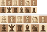

<!-- généré par scripts/catalogue_pages.py — ne pas éditer à la main -->

[Accueil](../index.md)

# Jeu echecs-kid

Dépôt : [echecs-kid](../sources/echecs-kid.md) · 12 asset(s) employés (usages actifs de l'index d'usage)

Licences : [MIT](../licences/MIT.md) 7 · [unknown](../licences/unknown.md) 5

| Vignette | Fiche | Nom | Catégorie | Licence | Auteur | Commits | Planche |
|---|---|---|---|---|---|---|---|
| — | [`asset-audio-bravo-1-0001`](../../../catalog/assets/asset-audio-bravo-1-0001.json) | bravo.1 | audio | [unknown](../licences/unknown.md) | unknown | `9a0a7f8`, `f5cbe7f` | — |
| — | [`asset-audio-train-consigne-0001`](../../../catalog/assets/asset-audio-train-consigne-0001.json) | train.consigne | audio | [unknown](../licences/unknown.md) | unknown | `9a0a7f8`, `f5cbe7f` | — |
| — | [`asset-codegenerated-mascotte-0001`](../../../catalog/assets/asset-codegenerated-mascotte-0001.json) | mascotte | codegenerated | [MIT](../licences/MIT.md) | unknown | `9a0a7f8` | — |
| — | [`asset-codegenerated-pieces-0001`](../../../catalog/assets/asset-codegenerated-pieces-0001.json) | pieces | codegenerated | [MIT](../licences/MIT.md) | unknown | `9a0a7f8`, `f5cbe7f` | — |
|  | [`asset-image-mascotte-0001`](../../../catalog/assets/asset-image-mascotte-0001.json) | mascotte | image | [unknown](../licences/unknown.md) | unknown | `9a0a7f8`, `f5cbe7f` | — |
|  | [`asset-image-pieces-mobile-0001`](../../../catalog/assets/asset-image-pieces-mobile-0001.json) | pieces-mobile | image | [unknown](../licences/unknown.md) | unknown | `9a0a7f8`, `f5cbe7f` | — |
| — | [`asset-codegenerated-icones-0001`](../../../catalog/assets/asset-codegenerated-icones-0001.json) | icones | ui | [MIT](../licences/MIT.md) | unknown | `9a0a7f8` | — |
| — | [`asset-codegenerated-plateau-0001`](../../../catalog/assets/asset-codegenerated-plateau-0001.json) | plateau | ui | [MIT](../licences/MIT.md) | unknown | `9a0a7f8` | — |
|  | [`asset-image-echecs-192-0001`](../../../catalog/assets/asset-image-echecs-192-0001.json) | echecs-192 | ui | [MIT](../licences/MIT.md) | Davy45270 (icônes dessinées par scripts/make-icons.js depuis src/art/pieces.ts) | `9a0a7f8`, `f5cbe7f` | — |
|  | [`asset-image-echecs-512-0001`](../../../catalog/assets/asset-image-echecs-512-0001.json) | echecs-512 | ui | [MIT](../licences/MIT.md) | Davy45270 (icônes dessinées par scripts/make-icons.js depuis src/art/pieces.ts) | `9a0a7f8`, `f5cbe7f` | — |
|  | [`asset-image-echecs-maskable-512-0001`](../../../catalog/assets/asset-image-echecs-maskable-512-0001.json) | echecs-maskable-512 | ui | [MIT](../licences/MIT.md) | Davy45270 (icônes dessinées par scripts/make-icons.js depuis src/art/pieces.ts) | `9a0a7f8`, `f5cbe7f` | — |
| — | [`asset-style-style-0002`](../../../catalog/assets/asset-style-style-0002.json) | style | ui | [unknown](../licences/unknown.md) | unknown | `9a0a7f8`, `f5cbe7f` | — |
