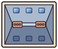

<!-- généré par scripts/catalogue_pages.py — ne pas éditer à la main -->

[Accueil](../index.md)

# Jeu opencade/derapage

Dépôt : [opencade](../sources/opencade.md) · 122 asset(s) employés (usages actifs de l'index d'usage)

Licences : [MIT](../licences/MIT.md) 122

| Vignette | Fiche | Nom | Catégorie | Licence | Auteur | Commits | Planche |
|---|---|---|---|---|---|---|---|
| — | [`asset-codegenerated-arcade-phaser-0001`](../../../catalog/assets/asset-codegenerated-arcade-phaser-0001.json) | arcade-phaser | characters | [MIT](../licences/MIT.md) | unknown | `172156a` | — |
|  | [`asset-image-dragon-back-0001`](../../../catalog/assets/asset-image-dragon-back-0001.json) | dragon_back | characters | [MIT](../licences/MIT.md) | outil IA (ChatGPT) sur commande de David, découpé et réduit par l'agent | `172156a` | — |
|  | [`asset-image-dragon-backleft-0001`](../../../catalog/assets/asset-image-dragon-backleft-0001.json) | dragon_backLeft | characters | [MIT](../licences/MIT.md) | outil IA (ChatGPT) sur commande de David, découpé et réduit par l'agent | `172156a` | — |
|  | [`asset-image-dragon-backright-0001`](../../../catalog/assets/asset-image-dragon-backright-0001.json) | dragon_backRight | characters | [MIT](../licences/MIT.md) | outil IA (ChatGPT) sur commande de David, découpé et réduit par l'agent | `172156a` | — |
|  | [`asset-image-dragon-front-0001`](../../../catalog/assets/asset-image-dragon-front-0001.json) | dragon_front | characters | [MIT](../licences/MIT.md) | outil IA (ChatGPT) sur commande de David, découpé et réduit par l'agent | `172156a` | — |
|  | [`asset-image-dragon-frontleft-0001`](../../../catalog/assets/asset-image-dragon-frontleft-0001.json) | dragon_frontLeft | characters | [MIT](../licences/MIT.md) | outil IA (ChatGPT) sur commande de David, découpé et réduit par l'agent | `172156a` | — |
|  | [`asset-image-dragon-frontright-0001`](../../../catalog/assets/asset-image-dragon-frontright-0001.json) | dragon_frontRight | characters | [MIT](../licences/MIT.md) | outil IA (ChatGPT) sur commande de David, découpé et réduit par l'agent | `172156a` | — |
|  | [`asset-image-dragon-left-0001`](../../../catalog/assets/asset-image-dragon-left-0001.json) | dragon_left | characters | [MIT](../licences/MIT.md) | outil IA (ChatGPT) sur commande de David, découpé et réduit par l'agent | `172156a` | — |
|  | [`asset-image-dragon-right-0001`](../../../catalog/assets/asset-image-dragon-right-0001.json) | dragon_right | characters | [MIT](../licences/MIT.md) | outil IA (ChatGPT) sur commande de David, découpé et réduit par l'agent | `172156a` | — |
|  | [`asset-image-dragon-top-0001`](../../../catalog/assets/asset-image-dragon-top-0001.json) | dragon_top | characters | [MIT](../licences/MIT.md) | outil IA (ChatGPT) sur commande de David, découpé et réduit par l'agent | `172156a` | — |
|  | [`asset-image-licorne-back-0001`](../../../catalog/assets/asset-image-licorne-back-0001.json) | licorne_back | characters | [MIT](../licences/MIT.md) | outil IA (ChatGPT) sur commande de David, découpé et réduit par l'agent | `172156a` | — |
|  | [`asset-image-licorne-backleft-0001`](../../../catalog/assets/asset-image-licorne-backleft-0001.json) | licorne_backLeft | characters | [MIT](../licences/MIT.md) | outil IA (ChatGPT) sur commande de David, découpé et réduit par l'agent | `172156a` | — |
|  | [`asset-image-licorne-backright-0001`](../../../catalog/assets/asset-image-licorne-backright-0001.json) | licorne_backRight | characters | [MIT](../licences/MIT.md) | outil IA (ChatGPT) sur commande de David, découpé et réduit par l'agent | `172156a` | — |
|  | [`asset-image-licorne-front-0001`](../../../catalog/assets/asset-image-licorne-front-0001.json) | licorne_front | characters | [MIT](../licences/MIT.md) | outil IA (ChatGPT) sur commande de David, découpé et réduit par l'agent | `172156a` | — |
|  | [`asset-image-licorne-frontleft-0001`](../../../catalog/assets/asset-image-licorne-frontleft-0001.json) | licorne_frontLeft | characters | [MIT](../licences/MIT.md) | outil IA (ChatGPT) sur commande de David, découpé et réduit par l'agent | `172156a` | — |
|  | [`asset-image-licorne-frontright-0001`](../../../catalog/assets/asset-image-licorne-frontright-0001.json) | licorne_frontRight | characters | [MIT](../licences/MIT.md) | outil IA (ChatGPT) sur commande de David, découpé et réduit par l'agent | `172156a` | — |
|  | [`asset-image-licorne-left-0001`](../../../catalog/assets/asset-image-licorne-left-0001.json) | licorne_left | characters | [MIT](../licences/MIT.md) | outil IA (ChatGPT) sur commande de David, découpé et réduit par l'agent | `172156a` | — |
|  | [`asset-image-licorne-right-0001`](../../../catalog/assets/asset-image-licorne-right-0001.json) | licorne_right | characters | [MIT](../licences/MIT.md) | outil IA (ChatGPT) sur commande de David, découpé et réduit par l'agent | `172156a` | — |
|  | [`asset-image-licorne-top-0001`](../../../catalog/assets/asset-image-licorne-top-0001.json) | licorne_top | characters | [MIT](../licences/MIT.md) | outil IA (ChatGPT) sur commande de David, découpé et réduit par l'agent | `172156a` | — |
|  | [`asset-image-panda-back-0001`](../../../catalog/assets/asset-image-panda-back-0001.json) | panda_back | characters | [MIT](../licences/MIT.md) | outil IA (ChatGPT) sur commande de David, découpé et réduit par l'agent | `172156a` | — |
|  | [`asset-image-panda-backleft-0001`](../../../catalog/assets/asset-image-panda-backleft-0001.json) | panda_backLeft | characters | [MIT](../licences/MIT.md) | outil IA (ChatGPT) sur commande de David, découpé et réduit par l'agent | `172156a` | — |
|  | [`asset-image-panda-backright-0001`](../../../catalog/assets/asset-image-panda-backright-0001.json) | panda_backRight | characters | [MIT](../licences/MIT.md) | outil IA (ChatGPT) sur commande de David, découpé et réduit par l'agent | `172156a` | — |
|  | [`asset-image-panda-front-0001`](../../../catalog/assets/asset-image-panda-front-0001.json) | panda_front | characters | [MIT](../licences/MIT.md) | outil IA (ChatGPT) sur commande de David, découpé et réduit par l'agent | `172156a` | — |
|  | [`asset-image-panda-frontleft-0001`](../../../catalog/assets/asset-image-panda-frontleft-0001.json) | panda_frontLeft | characters | [MIT](../licences/MIT.md) | outil IA (ChatGPT) sur commande de David, découpé et réduit par l'agent | `172156a` | — |
|  | [`asset-image-panda-frontright-0001`](../../../catalog/assets/asset-image-panda-frontright-0001.json) | panda_frontRight | characters | [MIT](../licences/MIT.md) | outil IA (ChatGPT) sur commande de David, découpé et réduit par l'agent | `172156a` | — |
|  | [`asset-image-panda-left-0001`](../../../catalog/assets/asset-image-panda-left-0001.json) | panda_left | characters | [MIT](../licences/MIT.md) | outil IA (ChatGPT) sur commande de David, découpé et réduit par l'agent | `172156a` | — |
|  | [`asset-image-panda-right-0001`](../../../catalog/assets/asset-image-panda-right-0001.json) | panda_right | characters | [MIT](../licences/MIT.md) | outil IA (ChatGPT) sur commande de David, découpé et réduit par l'agent | `172156a` | — |
|  | [`asset-image-panda-top-0001`](../../../catalog/assets/asset-image-panda-top-0001.json) | panda_top | characters | [MIT](../licences/MIT.md) | outil IA (ChatGPT) sur commande de David, découpé et réduit par l'agent | `172156a` | — |
|  | [`asset-image-pandaroux-back-0001`](../../../catalog/assets/asset-image-pandaroux-back-0001.json) | pandaroux_back | characters | [MIT](../licences/MIT.md) | outil IA (ChatGPT) sur commande de David, découpé et réduit par l'agent | `172156a` | — |
|  | [`asset-image-pandaroux-backleft-0001`](../../../catalog/assets/asset-image-pandaroux-backleft-0001.json) | pandaroux_backLeft | characters | [MIT](../licences/MIT.md) | outil IA (ChatGPT) sur commande de David, découpé et réduit par l'agent | `172156a` | — |
|  | [`asset-image-pandaroux-backright-0001`](../../../catalog/assets/asset-image-pandaroux-backright-0001.json) | pandaroux_backRight | characters | [MIT](../licences/MIT.md) | outil IA (ChatGPT) sur commande de David, découpé et réduit par l'agent | `172156a` | — |
|  | [`asset-image-pandaroux-front-0001`](../../../catalog/assets/asset-image-pandaroux-front-0001.json) | pandaroux_front | characters | [MIT](../licences/MIT.md) | outil IA (ChatGPT) sur commande de David, découpé et réduit par l'agent | `172156a` | — |
|  | [`asset-image-pandaroux-frontleft-0001`](../../../catalog/assets/asset-image-pandaroux-frontleft-0001.json) | pandaroux_frontLeft | characters | [MIT](../licences/MIT.md) | outil IA (ChatGPT) sur commande de David, découpé et réduit par l'agent | `172156a` | — |
|  | [`asset-image-pandaroux-frontright-0001`](../../../catalog/assets/asset-image-pandaroux-frontright-0001.json) | pandaroux_frontRight | characters | [MIT](../licences/MIT.md) | outil IA (ChatGPT) sur commande de David, découpé et réduit par l'agent | `172156a` | — |
|  | [`asset-image-pandaroux-left-0001`](../../../catalog/assets/asset-image-pandaroux-left-0001.json) | pandaroux_left | characters | [MIT](../licences/MIT.md) | outil IA (ChatGPT) sur commande de David, découpé et réduit par l'agent | `172156a` | — |
|  | [`asset-image-pandaroux-right-0001`](../../../catalog/assets/asset-image-pandaroux-right-0001.json) | pandaroux_right | characters | [MIT](../licences/MIT.md) | outil IA (ChatGPT) sur commande de David, découpé et réduit par l'agent | `172156a` | — |
|  | [`asset-image-pandaroux-top-0001`](../../../catalog/assets/asset-image-pandaroux-top-0001.json) | pandaroux_top | characters | [MIT](../licences/MIT.md) | outil IA (ChatGPT) sur commande de David, découpé et réduit par l'agent | `172156a` | — |
|  | [`asset-image-singe-back-0001`](../../../catalog/assets/asset-image-singe-back-0001.json) | singe_back | characters | [MIT](../licences/MIT.md) | outil IA (ChatGPT) sur commande de David, découpé et réduit par l'agent | `172156a` | — |
|  | [`asset-image-singe-backleft-0001`](../../../catalog/assets/asset-image-singe-backleft-0001.json) | singe_backLeft | characters | [MIT](../licences/MIT.md) | outil IA (ChatGPT) sur commande de David, découpé et réduit par l'agent | `172156a` | — |
|  | [`asset-image-singe-backright-0001`](../../../catalog/assets/asset-image-singe-backright-0001.json) | singe_backRight | characters | [MIT](../licences/MIT.md) | outil IA (ChatGPT) sur commande de David, découpé et réduit par l'agent | `172156a` | — |
|  | [`asset-image-singe-front-0001`](../../../catalog/assets/asset-image-singe-front-0001.json) | singe_front | characters | [MIT](../licences/MIT.md) | outil IA (ChatGPT) sur commande de David, découpé et réduit par l'agent | `172156a` | — |
|  | [`asset-image-singe-frontleft-0001`](../../../catalog/assets/asset-image-singe-frontleft-0001.json) | singe_frontLeft | characters | [MIT](../licences/MIT.md) | outil IA (ChatGPT) sur commande de David, découpé et réduit par l'agent | `172156a` | — |
|  | [`asset-image-singe-frontright-0001`](../../../catalog/assets/asset-image-singe-frontright-0001.json) | singe_frontRight | characters | [MIT](../licences/MIT.md) | outil IA (ChatGPT) sur commande de David, découpé et réduit par l'agent | `172156a` | — |
|  | [`asset-image-singe-left-0001`](../../../catalog/assets/asset-image-singe-left-0001.json) | singe_left | characters | [MIT](../licences/MIT.md) | outil IA (ChatGPT) sur commande de David, découpé et réduit par l'agent | `172156a` | — |
|  | [`asset-image-singe-right-0001`](../../../catalog/assets/asset-image-singe-right-0001.json) | singe_right | characters | [MIT](../licences/MIT.md) | outil IA (ChatGPT) sur commande de David, découpé et réduit par l'agent | `172156a` | — |
|  | [`asset-image-singe-top-0001`](../../../catalog/assets/asset-image-singe-top-0001.json) | singe_top | characters | [MIT](../licences/MIT.md) | outil IA (ChatGPT) sur commande de David, découpé et réduit par l'agent | `172156a` | — |
| — | [`asset-codegenerated-road-0001`](../../../catalog/assets/asset-codegenerated-road-0001.json) | road | codegenerated | [MIT](../licences/MIT.md) | unknown | `172156a` | — |
| — | [`asset-codegenerated-scene-0011`](../../../catalog/assets/asset-codegenerated-scene-0011.json) | scene | codegenerated | [MIT](../licences/MIT.md) | unknown | `172156a` | — |
|  | [`asset-image-bambou-0001`](../../../catalog/assets/asset-image-bambou-0001.json) | bambou | image | [MIT](../licences/MIT.md) | outil IA (ChatGPT) sur commande de David, raccordés et incrustés par l'agent (outils horizon.py) | `172156a` | — |
|  | [`asset-image-bambou-side-0001`](../../../catalog/assets/asset-image-bambou-side-0001.json) | bambou_side | image | [MIT](../licences/MIT.md) | outil IA (ChatGPT) sur commande de David, agrandis et détourés par l'agent | `172156a` | — |
|  | [`asset-image-bambou-side-far-0001`](../../../catalog/assets/asset-image-bambou-side-far-0001.json) | bambou_side_far | image | [MIT](../licences/MIT.md) | outil IA (ChatGPT) sur commande de David, agrandis et détourés par l'agent | `172156a` | — |
|  | [`asset-image-barriere-3q-0001`](../../../catalog/assets/asset-image-barriere-3q-0001.json) | barriere_3q | image | [MIT](../licences/MIT.md) | outil IA (ChatGPT) sur commande de David, découpé par l'agent | `172156a` | — |
|  | [`asset-image-barriere-3q-g-0001`](../../../catalog/assets/asset-image-barriere-3q-g-0001.json) | barriere_3q_g | image | [MIT](../licences/MIT.md) | outil IA (ChatGPT) sur commande de David, découpé par l'agent | `172156a` | — |
|  | [`asset-image-barriere-dessus-0001`](../../../catalog/assets/asset-image-barriere-dessus-0001.json) | barriere_dessus | image | [MIT](../licences/MIT.md) | outil IA (ChatGPT) sur commande de David, découpé par l'agent | `172156a` | — |
|  | [`asset-image-barriere-face-0001`](../../../catalog/assets/asset-image-barriere-face-0001.json) | barriere_face | image | [MIT](../licences/MIT.md) | outil IA (ChatGPT) sur commande de David, découpé par l'agent | `172156a` | — |
|  | [`asset-image-barriere-profil-0001`](../../../catalog/assets/asset-image-barriere-profil-0001.json) | barriere_profil | image | [MIT](../licences/MIT.md) | outil IA (ChatGPT) sur commande de David, découpé par l'agent | `172156a` | — |
|  | [`asset-image-barriere-profil-g-0001`](../../../catalog/assets/asset-image-barriere-profil-g-0001.json) | barriere_profil_g | image | [MIT](../licences/MIT.md) | outil IA (ChatGPT) sur commande de David, découpé par l'agent | `172156a` | — |
|  | [`asset-image-caisse-dessus-0001`](../../../catalog/assets/asset-image-caisse-dessus-0001.json) | caisse_dessus | image | [MIT](../licences/MIT.md) | outil IA (ChatGPT) sur commande de David, découpé par l'agent | `172156a` | — |
|  | [`asset-image-caisse-face-0001`](../../../catalog/assets/asset-image-caisse-face-0001.json) | caisse_face | image | [MIT](../licences/MIT.md) | outil IA (ChatGPT) sur commande de David, découpé par l'agent | `172156a` | — |
|  | [`asset-image-capsule-0001`](../../../catalog/assets/asset-image-capsule-0001.json) | capsule | image | [MIT](../licences/MIT.md) | outil IA (ChatGPT) sur commande de David | `172156a` | — |
|  | [`asset-image-capsule-far-0001`](../../../catalog/assets/asset-image-capsule-far-0001.json) | capsule_far | image | [MIT](../licences/MIT.md) | outil IA (ChatGPT) sur commande de David | `172156a` | — |
|  | [`asset-image-capsule-top-0001`](../../../catalog/assets/asset-image-capsule-top-0001.json) | capsule_top | image | [MIT](../licences/MIT.md) | outil IA (ChatGPT) sur commande de David | `172156a` | — |
|  | [`asset-image-cerisier-side-0001`](../../../catalog/assets/asset-image-cerisier-side-0001.json) | cerisier_side | image | [MIT](../licences/MIT.md) | outil IA (ChatGPT) sur commande de David, agrandis et détourés par l'agent | `172156a` | — |
|  | [`asset-image-cerisier-side-far-0001`](../../../catalog/assets/asset-image-cerisier-side-far-0001.json) | cerisier_side_far | image | [MIT](../licences/MIT.md) | outil IA (ChatGPT) sur commande de David, agrandis et détourés par l'agent | `172156a` | — |
|  | [`asset-image-cerisier-top-0001`](../../../catalog/assets/asset-image-cerisier-top-0001.json) | cerisier_top | image | [MIT](../licences/MIT.md) | outil IA (ChatGPT) sur commande de David, agrandis et détourés par l'agent | `172156a` | — |
|  | [`asset-image-cloud-top-0001`](../../../catalog/assets/asset-image-cloud-top-0001.json) | cloud_top | image | [MIT](../licences/MIT.md) | outil IA (ChatGPT) sur commande de David | `172156a` | — |
|  | [`asset-image-colonne-dessus-0001`](../../../catalog/assets/asset-image-colonne-dessus-0001.json) | colonne_dessus | image | [MIT](../licences/MIT.md) | code généré (agent, gen.py) sur commande de David — Opencade 40113b1 ; source archivée au registre d'assets (sources/editable/derapage-paris) | `172156a` | — |
|  | [`asset-image-colonne-face-0001`](../../../catalog/assets/asset-image-colonne-face-0001.json) | colonne_face | image | [MIT](../licences/MIT.md) | code généré (agent, gen.py) sur commande de David — Opencade 40113b1 ; source archivée au registre d'assets (sources/editable/derapage-paris) | `172156a` | — |
|  | [`asset-image-erable-side-0001`](../../../catalog/assets/asset-image-erable-side-0001.json) | erable_side | image | [MIT](../licences/MIT.md) | outil IA (ChatGPT) sur commande de David, agrandis et détourés par l'agent | `172156a` | — |
|  | [`asset-image-erable-side-far-0001`](../../../catalog/assets/asset-image-erable-side-far-0001.json) | erable_side_far | image | [MIT](../licences/MIT.md) | outil IA (ChatGPT) sur commande de David, agrandis et détourés par l'agent | `172156a` | — |
|  | [`asset-image-erable-top-0001`](../../../catalog/assets/asset-image-erable-top-0001.json) | erable_top | image | [MIT](../licences/MIT.md) | outil IA (ChatGPT) sur commande de David, agrandis et détourés par l'agent | `172156a` | — |
|  | [`asset-image-falaises-0001`](../../../catalog/assets/asset-image-falaises-0001.json) | falaises | image | [MIT](../licences/MIT.md) | outil IA (ChatGPT) sur commande de David, raccordés et incrustés par l'agent (outils horizon.py) | `172156a` | — |
|  | [`asset-image-feuilles-0001`](../../../catalog/assets/asset-image-feuilles-0001.json) | feuilles | image | [MIT](../licences/MIT.md) | outil IA (ChatGPT) sur commande de David, raccordés et incrustés par l'agent (outils horizon.py) | `172156a` | — |
|  | [`asset-image-feuillu-side-0001`](../../../catalog/assets/asset-image-feuillu-side-0001.json) | feuillu_side | image | [MIT](../licences/MIT.md) | outil IA (ChatGPT) sur commande de David, agrandis et détourés par l'agent | `172156a` | — |
|  | [`asset-image-feuillu-side-far-0001`](../../../catalog/assets/asset-image-feuillu-side-far-0001.json) | feuillu_side_far | image | [MIT](../licences/MIT.md) | outil IA (ChatGPT) sur commande de David, agrandis et détourés par l'agent | `172156a` | — |
|  | [`asset-image-feuillu-top-0001`](../../../catalog/assets/asset-image-feuillu-top-0001.json) | feuillu_top | image | [MIT](../licences/MIT.md) | outil IA (ChatGPT) sur commande de David, agrandis et détourés par l'agent | `172156a` | — |
|  | [`asset-image-immeuble-dessus-0001`](../../../catalog/assets/asset-image-immeuble-dessus-0001.json) | immeuble_dessus | image | [MIT](../licences/MIT.md) | code généré (agent, gen.py) sur commande de David — Opencade 40113b1 ; source archivée au registre d'assets (sources/editable/derapage-paris) | `172156a` | — |
|  | [`asset-image-immeuble-face-0001`](../../../catalog/assets/asset-image-immeuble-face-0001.json) | immeuble_face | image | [MIT](../licences/MIT.md) | code généré (agent, gen.py) sur commande de David — Opencade 40113b1 ; source archivée au registre d'assets (sources/editable/derapage-paris) | `172156a` | — |
|  | [`asset-image-immeuble2-face-0001`](../../../catalog/assets/asset-image-immeuble2-face-0001.json) | immeuble2_face | image | [MIT](../licences/MIT.md) | code généré (agent, gen.py) sur commande de David — Opencade 40113b1 ; source archivée au registre d'assets (sources/editable/derapage-paris) | `172156a` | — |
|  | [`asset-image-lampadaire-dessus-0001`](../../../catalog/assets/asset-image-lampadaire-dessus-0001.json) | lampadaire_dessus | image | [MIT](../licences/MIT.md) | code généré (agent, gen.py) sur commande de David — Opencade 40113b1 ; source archivée au registre d'assets (sources/editable/derapage-paris) | `172156a` | — |
|  | [`asset-image-lampadaire-face-0001`](../../../catalog/assets/asset-image-lampadaire-face-0001.json) | lampadaire_face | image | [MIT](../licences/MIT.md) | code généré (agent, gen.py) sur commande de David — Opencade 40113b1 ; source archivée au registre d'assets (sources/editable/derapage-paris) | `172156a` | — |
|  | [`asset-image-nature-0001`](../../../catalog/assets/asset-image-nature-0001.json) | nature | image | [MIT](../licences/MIT.md) | outil IA (ChatGPT) sur commande de David, raccordés et incrustés par l'agent (outils horizon.py) | `172156a` | — |
|  | [`asset-image-ovales-0001`](../../../catalog/assets/asset-image-ovales-0001.json) | ovales | image | [MIT](../licences/MIT.md) | outil IA (ChatGPT) sur commande de David, raccordés et incrustés par l'agent (outils horizon.py) | `172156a` | — |
|  | [`asset-image-palmier-side-0001`](../../../catalog/assets/asset-image-palmier-side-0001.json) | palmier_side | image | [MIT](../licences/MIT.md) | outil IA (ChatGPT) sur commande de David, agrandis et détourés par l'agent | `172156a` | — |
|  | [`asset-image-palmier-side-far-0001`](../../../catalog/assets/asset-image-palmier-side-far-0001.json) | palmier_side_far | image | [MIT](../licences/MIT.md) | outil IA (ChatGPT) sur commande de David, agrandis et détourés par l'agent | `172156a` | — |
|  | [`asset-image-palmier-top-0001`](../../../catalog/assets/asset-image-palmier-top-0001.json) | palmier_top | image | [MIT](../licences/MIT.md) | outil IA (ChatGPT) sur commande de David, agrandis et détourés par l'agent | `172156a` | — |
|  | [`asset-image-panneau-arriere-0001`](../../../catalog/assets/asset-image-panneau-arriere-0001.json) | panneau_arriere | image | [MIT](../licences/MIT.md) | outil IA (ChatGPT) sur commande de David, découpé par l'agent | `172156a` | — |
|  | [`asset-image-panneau-arriere-g-0001`](../../../catalog/assets/asset-image-panneau-arriere-g-0001.json) | panneau_arriere_g | image | [MIT](../licences/MIT.md) | outil IA (ChatGPT) sur commande de David, découpé par l'agent | `172156a` | — |
|  | [`asset-image-panneau-cote-0001`](../../../catalog/assets/asset-image-panneau-cote-0001.json) | panneau_cote | image | [MIT](../licences/MIT.md) | outil IA (ChatGPT) sur commande de David, découpé par l'agent | `172156a` | — |
|  | [`asset-image-panneau-cote-g-0001`](../../../catalog/assets/asset-image-panneau-cote-g-0001.json) | panneau_cote_g | image | [MIT](../licences/MIT.md) | outil IA (ChatGPT) sur commande de David, découpé par l'agent | `172156a` | — |
|  | [`asset-image-panneau-dessus-0001`](../../../catalog/assets/asset-image-panneau-dessus-0001.json) | panneau_dessus | image | [MIT](../licences/MIT.md) | outil IA (ChatGPT) sur commande de David, découpé par l'agent | `172156a` | — |
|  | [`asset-image-panneau-dessus-g-0001`](../../../catalog/assets/asset-image-panneau-dessus-g-0001.json) | panneau_dessus_g | image | [MIT](../licences/MIT.md) | outil IA (ChatGPT) sur commande de David, découpé par l'agent | `172156a` | — |
|  | [`asset-image-panneau-face-0001`](../../../catalog/assets/asset-image-panneau-face-0001.json) | panneau_face | image | [MIT](../licences/MIT.md) | outil IA (ChatGPT) sur commande de David, découpé par l'agent | `172156a` | — |
|  | [`asset-image-panneau-face-g-0001`](../../../catalog/assets/asset-image-panneau-face-g-0001.json) | panneau_face_g | image | [MIT](../licences/MIT.md) | outil IA (ChatGPT) sur commande de David, découpé par l'agent | `172156a` | — |
|  | [`asset-image-panneau2-dessus-0001`](../../../catalog/assets/asset-image-panneau2-dessus-0001.json) | panneau2_dessus | image | [MIT](../licences/MIT.md) | outil IA (ChatGPT) sur commande de David, découpé par l'agent | `172156a` | — |
|  | [`asset-image-pneus-dessus-0001`](../../../catalog/assets/asset-image-pneus-dessus-0001.json) | pneus_dessus | image | [MIT](../licences/MIT.md) | outil IA (ChatGPT) sur commande de David, découpé par l'agent | `172156a` | — |
|  | [`asset-image-pneus-face-0001`](../../../catalog/assets/asset-image-pneus-face-0001.json) | pneus_face | image | [MIT](../licences/MIT.md) | outil IA (ChatGPT) sur commande de David, découpé par l'agent | `172156a` | — |
|  | [`asset-image-pommier-side-0001`](../../../catalog/assets/asset-image-pommier-side-0001.json) | pommier_side | image | [MIT](../licences/MIT.md) | outil IA (ChatGPT) sur commande de David, agrandis et détourés par l'agent | `172156a` | — |
|  | [`asset-image-pommier-side-far-0001`](../../../catalog/assets/asset-image-pommier-side-far-0001.json) | pommier_side_far | image | [MIT](../licences/MIT.md) | outil IA (ChatGPT) sur commande de David, agrandis et détourés par l'agent | `172156a` | — |
|  | [`asset-image-pommier-top-0001`](../../../catalog/assets/asset-image-pommier-top-0001.json) | pommier_top | image | [MIT](../licences/MIT.md) | outil IA (ChatGPT) sur commande de David, agrandis et détourés par l'agent | `172156a` | — |
|  | [`asset-image-quais-0002`](../../../catalog/assets/asset-image-quais-0002.json) | quais | image | [MIT](../licences/MIT.md) | outil IA (ChatGPT) sur commande de David, raccordés et incrustés par l'agent (outils horizon.py) | `172156a` | — |
|  | [`asset-image-rampe-0-0001`](../../../catalog/assets/asset-image-rampe-0-0001.json) | rampe_0 | image | [MIT](../licences/MIT.md) | outil IA (ChatGPT) sur commande de David, découpé par l'agent | `172156a` | — |
|  | [`asset-image-rampe-0001`](../../../catalog/assets/asset-image-rampe-0001.json) | rampe | image | [MIT](../licences/MIT.md) | outil IA (ChatGPT) sur commande de David, découpé par l'agent | `172156a` | — |
|  | [`asset-image-rampe-1-0001`](../../../catalog/assets/asset-image-rampe-1-0001.json) | rampe_1 | image | [MIT](../licences/MIT.md) | outil IA (ChatGPT) sur commande de David, découpé par l'agent | `172156a` | — |
|  | [`asset-image-rampe-2-0001`](../../../catalog/assets/asset-image-rampe-2-0001.json) | rampe_2 | image | [MIT](../licences/MIT.md) | outil IA (ChatGPT) sur commande de David, découpé par l'agent | `172156a` | — |
|  | [`asset-image-rampe-3-0001`](../../../catalog/assets/asset-image-rampe-3-0001.json) | rampe_3 | image | [MIT](../licences/MIT.md) | outil IA (ChatGPT) sur commande de David, découpé par l'agent | `172156a` | — |
|  | [`asset-image-rapide-0002`](../../../catalog/assets/asset-image-rapide-0002.json) | rapide | image | [MIT](../licences/MIT.md) | outil IA (ChatGPT) sur commande de David, raccordés et incrustés par l'agent (outils horizon.py) | `172156a` | — |
|  | [`asset-image-sapin-side-0001`](../../../catalog/assets/asset-image-sapin-side-0001.json) | sapin_side | image | [MIT](../licences/MIT.md) | outil IA (ChatGPT) sur commande de David, agrandis et détourés par l'agent | `172156a` | — |
|  | [`asset-image-sapin-side-far-0001`](../../../catalog/assets/asset-image-sapin-side-far-0001.json) | sapin_side_far | image | [MIT](../licences/MIT.md) | outil IA (ChatGPT) sur commande de David, agrandis et détourés par l'agent | `172156a` | — |
|  | [`asset-image-sapin-top-0001`](../../../catalog/assets/asset-image-sapin-top-0001.json) | sapin_top | image | [MIT](../licences/MIT.md) | outil IA (ChatGPT) sur commande de David, agrandis et détourés par l'agent | `172156a` | — |
|  | [`asset-image-slalom-0002`](../../../catalog/assets/asset-image-slalom-0002.json) | slalom | image | [MIT](../licences/MIT.md) | outil IA (ChatGPT) sur commande de David, raccordés et incrustés par l'agent (outils horizon.py) | `172156a` | — |
|  | [`asset-image-technique-0002`](../../../catalog/assets/asset-image-technique-0002.json) | technique | image | [MIT](../licences/MIT.md) | outil IA (ChatGPT) sur commande de David, raccordés et incrustés par l'agent (outils horizon.py) | `172156a` | — |
|  | [`asset-image-urbaine-0002`](../../../catalog/assets/asset-image-urbaine-0002.json) | urbaine | image | [MIT](../licences/MIT.md) | outil IA (ChatGPT) sur commande de David, raccordés et incrustés par l'agent (outils horizon.py) | `172156a` | — |
|  | [`asset-image-volcan-0002`](../../../catalog/assets/asset-image-volcan-0002.json) | volcan | image | [MIT](../licences/MIT.md) | outil IA (ChatGPT) sur commande de David, raccordés et incrustés par l'agent (outils horizon.py) | `172156a` | — |
|  | [`asset-image-icon-bulle-0001`](../../../catalog/assets/asset-image-icon-bulle-0001.json) | icon_bulle | ui | [MIT](../licences/MIT.md) | outil IA (ChatGPT) sur commande de David | `172156a` | — |
|  | [`asset-image-icon-bulle-small-0001`](../../../catalog/assets/asset-image-icon-bulle-small-0001.json) | icon_bulle_small | ui | [MIT](../licences/MIT.md) | outil IA (ChatGPT) sur commande de David | `172156a` | — |
|  | [`asset-image-icon-flaque-0001`](../../../catalog/assets/asset-image-icon-flaque-0001.json) | icon_flaque | ui | [MIT](../licences/MIT.md) | outil IA (ChatGPT) sur commande de David | `172156a` | — |
|  | [`asset-image-icon-flaque-small-0001`](../../../catalog/assets/asset-image-icon-flaque-small-0001.json) | icon_flaque_small | ui | [MIT](../licences/MIT.md) | outil IA (ChatGPT) sur commande de David | `172156a` | — |
|  | [`asset-image-icon-ressort-0001`](../../../catalog/assets/asset-image-icon-ressort-0001.json) | icon_ressort | ui | [MIT](../licences/MIT.md) | outil IA (ChatGPT) sur commande de David | `172156a` | — |
|  | [`asset-image-icon-ressort-small-0001`](../../../catalog/assets/asset-image-icon-ressort-small-0001.json) | icon_ressort_small | ui | [MIT](../licences/MIT.md) | outil IA (ChatGPT) sur commande de David | `172156a` | — |
|  | [`asset-image-icon-turbo-0001`](../../../catalog/assets/asset-image-icon-turbo-0001.json) | icon_turbo | ui | [MIT](../licences/MIT.md) | outil IA (ChatGPT) sur commande de David | `172156a` | — |
|  | [`asset-image-icon-turbo-small-0001`](../../../catalog/assets/asset-image-icon-turbo-small-0001.json) | icon_turbo_small | ui | [MIT](../licences/MIT.md) | outil IA (ChatGPT) sur commande de David | `172156a` | — |
