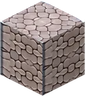

<!-- généré par scripts/catalogue_pages.py — ne pas éditer à la main -->

[Accueil](../index.md)

# Jeu opencade/petits-pompiers

Dépôt : [opencade](../sources/opencade.md) · 139 asset(s) employés (usages actifs de l'index d'usage)

Licences : [MIT](../licences/MIT.md) 139

| Vignette | Fiche | Nom | Catégorie | Licence | Auteur | Commits | Planche |
|---|---|---|---|---|---|---|---|
|  | [`asset-image-chaton-appel-0001`](../../../catalog/assets/asset-image-chaton-appel-0001.json) | chaton_appel | characters | [MIT](../licences/MIT.md) | outil IA (ChatGPT) sur commande de David, découpé par l'agent | `172156a` | — |
|  | [`asset-image-chaton-heureux-0001`](../../../catalog/assets/asset-image-chaton-heureux-0001.json) | chaton_heureux | characters | [MIT](../licences/MIT.md) | outil IA (ChatGPT) sur commande de David, découpé par l'agent | `172156a` | — |
|  | [`asset-image-chaton-soulage-0001`](../../../catalog/assets/asset-image-chaton-soulage-0001.json) | chaton_soulage | characters | [MIT](../licences/MIT.md) | outil IA (ChatGPT) sur commande de David, découpé par l'agent | `172156a` | — |
|  | [`asset-image-chien-dos-0001`](../../../catalog/assets/asset-image-chien-dos-0001.json) | chien_dos | characters | [MIT](../licences/MIT.md) | outil IA (ChatGPT) sur commande de David, découpé par l'agent | `172156a` | — |
|  | [`asset-image-chien-profil-0001`](../../../catalog/assets/asset-image-chien-profil-0001.json) | chien_profil | characters | [MIT](../licences/MIT.md) | outil IA (ChatGPT) sur commande de David, découpé par l'agent | `172156a` | — |
|  | [`asset-image-enfant-chloe-attente-0001`](../../../catalog/assets/asset-image-enfant-chloe-attente-0001.json) | enfant_chloe_attente | characters | [MIT](../licences/MIT.md) | outil IA (ChatGPT) sur commande de David (cycles de marche), découpé par l'agent | `172156a` | — |
|  | [`asset-image-enfant-chloe-marche1-0001`](../../../catalog/assets/asset-image-enfant-chloe-marche1-0001.json) | enfant_chloe_marche1 | characters | [MIT](../licences/MIT.md) | outil IA (ChatGPT) sur commande de David (cycles de marche), découpé par l'agent | `172156a` | — |
|  | [`asset-image-enfant-chloe-marche2-0001`](../../../catalog/assets/asset-image-enfant-chloe-marche2-0001.json) | enfant_chloe_marche2 | characters | [MIT](../licences/MIT.md) | outil IA (ChatGPT) sur commande de David (cycles de marche), découpé par l'agent | `172156a` | — |
|  | [`asset-image-enfant-chloe-marche3-0001`](../../../catalog/assets/asset-image-enfant-chloe-marche3-0001.json) | enfant_chloe_marche3 | characters | [MIT](../licences/MIT.md) | outil IA (ChatGPT) sur commande de David (cycles de marche), découpé par l'agent | `172156a` | — |
|  | [`asset-image-enfant-chloe-marche4-0001`](../../../catalog/assets/asset-image-enfant-chloe-marche4-0001.json) | enfant_chloe_marche4 | characters | [MIT](../licences/MIT.md) | outil IA (ChatGPT) sur commande de David (cycles de marche), découpé par l'agent | `172156a` | — |
|  | [`asset-image-enfant-chloe-marche5-0001`](../../../catalog/assets/asset-image-enfant-chloe-marche5-0001.json) | enfant_chloe_marche5 | characters | [MIT](../licences/MIT.md) | outil IA (ChatGPT) sur commande de David (cycles de marche), découpé par l'agent | `172156a` | — |
|  | [`asset-image-enfant-chloe-marche6-0001`](../../../catalog/assets/asset-image-enfant-chloe-marche6-0001.json) | enfant_chloe_marche6 | characters | [MIT](../licences/MIT.md) | outil IA (ChatGPT) sur commande de David (cycles de marche), découpé par l'agent | `172156a` | — |
|  | [`asset-image-enfant-chloe-marche7-0001`](../../../catalog/assets/asset-image-enfant-chloe-marche7-0001.json) | enfant_chloe_marche7 | characters | [MIT](../licences/MIT.md) | outil IA (ChatGPT) sur commande de David (cycles de marche), découpé par l'agent | `172156a` | — |
|  | [`asset-image-enfant-chloe-marche8-0001`](../../../catalog/assets/asset-image-enfant-chloe-marche8-0001.json) | enfant_chloe_marche8 | characters | [MIT](../licences/MIT.md) | outil IA (ChatGPT) sur commande de David (cycles de marche), découpé par l'agent | `172156a` | — |
|  | [`asset-image-enfant-emma-attente-0001`](../../../catalog/assets/asset-image-enfant-emma-attente-0001.json) | enfant_emma_attente | characters | [MIT](../licences/MIT.md) | outil IA (ChatGPT) sur commande de David (cycles de marche), découpé par l'agent | `172156a` | — |
|  | [`asset-image-enfant-emma-marche1-0001`](../../../catalog/assets/asset-image-enfant-emma-marche1-0001.json) | enfant_emma_marche1 | characters | [MIT](../licences/MIT.md) | outil IA (ChatGPT) sur commande de David (cycles de marche), découpé par l'agent | `172156a` | — |
|  | [`asset-image-enfant-emma-marche2-0001`](../../../catalog/assets/asset-image-enfant-emma-marche2-0001.json) | enfant_emma_marche2 | characters | [MIT](../licences/MIT.md) | outil IA (ChatGPT) sur commande de David (cycles de marche), découpé par l'agent | `172156a` | — |
|  | [`asset-image-enfant-emma-marche3-0001`](../../../catalog/assets/asset-image-enfant-emma-marche3-0001.json) | enfant_emma_marche3 | characters | [MIT](../licences/MIT.md) | outil IA (ChatGPT) sur commande de David (cycles de marche), découpé par l'agent | `172156a` | — |
|  | [`asset-image-enfant-emma-marche4-0001`](../../../catalog/assets/asset-image-enfant-emma-marche4-0001.json) | enfant_emma_marche4 | characters | [MIT](../licences/MIT.md) | outil IA (ChatGPT) sur commande de David (cycles de marche), découpé par l'agent | `172156a` | — |
|  | [`asset-image-enfant-emma-marche5-0001`](../../../catalog/assets/asset-image-enfant-emma-marche5-0001.json) | enfant_emma_marche5 | characters | [MIT](../licences/MIT.md) | outil IA (ChatGPT) sur commande de David (cycles de marche), découpé par l'agent | `172156a` | — |
|  | [`asset-image-enfant-emma-marche6-0001`](../../../catalog/assets/asset-image-enfant-emma-marche6-0001.json) | enfant_emma_marche6 | characters | [MIT](../licences/MIT.md) | outil IA (ChatGPT) sur commande de David (cycles de marche), découpé par l'agent | `172156a` | — |
|  | [`asset-image-enfant-emma-marche7-0001`](../../../catalog/assets/asset-image-enfant-emma-marche7-0001.json) | enfant_emma_marche7 | characters | [MIT](../licences/MIT.md) | outil IA (ChatGPT) sur commande de David (cycles de marche), découpé par l'agent | `172156a` | — |
|  | [`asset-image-enfant-emma-marche8-0001`](../../../catalog/assets/asset-image-enfant-emma-marche8-0001.json) | enfant_emma_marche8 | characters | [MIT](../licences/MIT.md) | outil IA (ChatGPT) sur commande de David (cycles de marche), découpé par l'agent | `172156a` | — |
|  | [`asset-image-enfant-ines-attente-0001`](../../../catalog/assets/asset-image-enfant-ines-attente-0001.json) | enfant_ines_attente | characters | [MIT](../licences/MIT.md) | outil IA (ChatGPT) sur commande de David (cycles de marche), découpé par l'agent | `172156a` | — |
|  | [`asset-image-enfant-ines-marche1-0001`](../../../catalog/assets/asset-image-enfant-ines-marche1-0001.json) | enfant_ines_marche1 | characters | [MIT](../licences/MIT.md) | outil IA (ChatGPT) sur commande de David (cycles de marche), découpé par l'agent | `172156a` | — |
|  | [`asset-image-enfant-ines-marche2-0001`](../../../catalog/assets/asset-image-enfant-ines-marche2-0001.json) | enfant_ines_marche2 | characters | [MIT](../licences/MIT.md) | outil IA (ChatGPT) sur commande de David (cycles de marche), découpé par l'agent | `172156a` | — |
|  | [`asset-image-enfant-ines-marche3-0001`](../../../catalog/assets/asset-image-enfant-ines-marche3-0001.json) | enfant_ines_marche3 | characters | [MIT](../licences/MIT.md) | outil IA (ChatGPT) sur commande de David (cycles de marche), découpé par l'agent | `172156a` | — |
|  | [`asset-image-enfant-ines-marche4-0001`](../../../catalog/assets/asset-image-enfant-ines-marche4-0001.json) | enfant_ines_marche4 | characters | [MIT](../licences/MIT.md) | outil IA (ChatGPT) sur commande de David (cycles de marche), découpé par l'agent | `172156a` | — |
|  | [`asset-image-enfant-ines-marche5-0001`](../../../catalog/assets/asset-image-enfant-ines-marche5-0001.json) | enfant_ines_marche5 | characters | [MIT](../licences/MIT.md) | outil IA (ChatGPT) sur commande de David (cycles de marche), découpé par l'agent | `172156a` | — |
|  | [`asset-image-enfant-ines-marche6-0001`](../../../catalog/assets/asset-image-enfant-ines-marche6-0001.json) | enfant_ines_marche6 | characters | [MIT](../licences/MIT.md) | outil IA (ChatGPT) sur commande de David (cycles de marche), découpé par l'agent | `172156a` | — |
|  | [`asset-image-enfant-ines-marche7-0001`](../../../catalog/assets/asset-image-enfant-ines-marche7-0001.json) | enfant_ines_marche7 | characters | [MIT](../licences/MIT.md) | outil IA (ChatGPT) sur commande de David (cycles de marche), découpé par l'agent | `172156a` | — |
|  | [`asset-image-enfant-ines-marche8-0001`](../../../catalog/assets/asset-image-enfant-ines-marche8-0001.json) | enfant_ines_marche8 | characters | [MIT](../licences/MIT.md) | outil IA (ChatGPT) sur commande de David (cycles de marche), découpé par l'agent | `172156a` | — |
|  | [`asset-image-enfant-lucas-attente-0001`](../../../catalog/assets/asset-image-enfant-lucas-attente-0001.json) | enfant_lucas_attente | characters | [MIT](../licences/MIT.md) | outil IA (ChatGPT) sur commande de David (cycles de marche), découpé par l'agent | `172156a` | — |
|  | [`asset-image-enfant-lucas-marche1-0001`](../../../catalog/assets/asset-image-enfant-lucas-marche1-0001.json) | enfant_lucas_marche1 | characters | [MIT](../licences/MIT.md) | outil IA (ChatGPT) sur commande de David (cycles de marche), découpé par l'agent | `172156a` | — |
|  | [`asset-image-enfant-lucas-marche2-0001`](../../../catalog/assets/asset-image-enfant-lucas-marche2-0001.json) | enfant_lucas_marche2 | characters | [MIT](../licences/MIT.md) | outil IA (ChatGPT) sur commande de David (cycles de marche), découpé par l'agent | `172156a` | — |
|  | [`asset-image-enfant-lucas-marche3-0001`](../../../catalog/assets/asset-image-enfant-lucas-marche3-0001.json) | enfant_lucas_marche3 | characters | [MIT](../licences/MIT.md) | outil IA (ChatGPT) sur commande de David (cycles de marche), découpé par l'agent | `172156a` | — |
|  | [`asset-image-enfant-lucas-marche4-0001`](../../../catalog/assets/asset-image-enfant-lucas-marche4-0001.json) | enfant_lucas_marche4 | characters | [MIT](../licences/MIT.md) | outil IA (ChatGPT) sur commande de David (cycles de marche), découpé par l'agent | `172156a` | — |
|  | [`asset-image-enfant-lucas-marche5-0001`](../../../catalog/assets/asset-image-enfant-lucas-marche5-0001.json) | enfant_lucas_marche5 | characters | [MIT](../licences/MIT.md) | outil IA (ChatGPT) sur commande de David (cycles de marche), découpé par l'agent | `172156a` | — |
|  | [`asset-image-enfant-lucas-marche6-0001`](../../../catalog/assets/asset-image-enfant-lucas-marche6-0001.json) | enfant_lucas_marche6 | characters | [MIT](../licences/MIT.md) | outil IA (ChatGPT) sur commande de David (cycles de marche), découpé par l'agent | `172156a` | — |
|  | [`asset-image-enfant-lucas-marche7-0001`](../../../catalog/assets/asset-image-enfant-lucas-marche7-0001.json) | enfant_lucas_marche7 | characters | [MIT](../licences/MIT.md) | outil IA (ChatGPT) sur commande de David (cycles de marche), découpé par l'agent | `172156a` | — |
|  | [`asset-image-enfant-lucas-marche8-0001`](../../../catalog/assets/asset-image-enfant-lucas-marche8-0001.json) | enfant_lucas_marche8 | characters | [MIT](../licences/MIT.md) | outil IA (ChatGPT) sur commande de David (cycles de marche), découpé par l'agent | `172156a` | — |
|  | [`asset-image-enfant-noe-attente-0001`](../../../catalog/assets/asset-image-enfant-noe-attente-0001.json) | enfant_noe_attente | characters | [MIT](../licences/MIT.md) | outil IA (ChatGPT) sur commande de David (cycles de marche), découpé par l'agent | `172156a` | — |
|  | [`asset-image-enfant-noe-marche1-0001`](../../../catalog/assets/asset-image-enfant-noe-marche1-0001.json) | enfant_noe_marche1 | characters | [MIT](../licences/MIT.md) | outil IA (ChatGPT) sur commande de David (cycles de marche), découpé par l'agent | `172156a` | — |
|  | [`asset-image-enfant-noe-marche2-0001`](../../../catalog/assets/asset-image-enfant-noe-marche2-0001.json) | enfant_noe_marche2 | characters | [MIT](../licences/MIT.md) | outil IA (ChatGPT) sur commande de David (cycles de marche), découpé par l'agent | `172156a` | — |
|  | [`asset-image-enfant-noe-marche3-0001`](../../../catalog/assets/asset-image-enfant-noe-marche3-0001.json) | enfant_noe_marche3 | characters | [MIT](../licences/MIT.md) | outil IA (ChatGPT) sur commande de David (cycles de marche), découpé par l'agent | `172156a` | — |
|  | [`asset-image-enfant-noe-marche4-0001`](../../../catalog/assets/asset-image-enfant-noe-marche4-0001.json) | enfant_noe_marche4 | characters | [MIT](../licences/MIT.md) | outil IA (ChatGPT) sur commande de David (cycles de marche), découpé par l'agent | `172156a` | — |
|  | [`asset-image-enfant-noe-marche5-0001`](../../../catalog/assets/asset-image-enfant-noe-marche5-0001.json) | enfant_noe_marche5 | characters | [MIT](../licences/MIT.md) | outil IA (ChatGPT) sur commande de David (cycles de marche), découpé par l'agent | `172156a` | — |
|  | [`asset-image-enfant-noe-marche6-0001`](../../../catalog/assets/asset-image-enfant-noe-marche6-0001.json) | enfant_noe_marche6 | characters | [MIT](../licences/MIT.md) | outil IA (ChatGPT) sur commande de David (cycles de marche), découpé par l'agent | `172156a` | — |
|  | [`asset-image-enfant-noe-marche7-0001`](../../../catalog/assets/asset-image-enfant-noe-marche7-0001.json) | enfant_noe_marche7 | characters | [MIT](../licences/MIT.md) | outil IA (ChatGPT) sur commande de David (cycles de marche), découpé par l'agent | `172156a` | — |
|  | [`asset-image-enfant-noe-marche8-0001`](../../../catalog/assets/asset-image-enfant-noe-marche8-0001.json) | enfant_noe_marche8 | characters | [MIT](../licences/MIT.md) | outil IA (ChatGPT) sur commande de David (cycles de marche), découpé par l'agent | `172156a` | — |
|  | [`asset-image-lapin-dos-0001`](../../../catalog/assets/asset-image-lapin-dos-0001.json) | lapin_dos | characters | [MIT](../licences/MIT.md) | outil IA (ChatGPT) sur commande de David, découpé par l'agent | `172156a` | — |
|  | [`asset-image-lapin-profil-0001`](../../../catalog/assets/asset-image-lapin-profil-0001.json) | lapin_profil | characters | [MIT](../licences/MIT.md) | outil IA (ChatGPT) sur commande de David, découpé par l'agent | `172156a` | — |
|  | [`asset-image-pompier-dragon-e-0001`](../../../catalog/assets/asset-image-pompier-dragon-e-0001.json) | pompier_dragon_E | characters | [MIT](../licences/MIT.md) | outil IA (ChatGPT) sur commande de David (planche multivues), découpé par l'agent | `172156a` | — |
|  | [`asset-image-pompier-dragon-n-0001`](../../../catalog/assets/asset-image-pompier-dragon-n-0001.json) | pompier_dragon_N | characters | [MIT](../licences/MIT.md) | outil IA (ChatGPT) sur commande de David (planche multivues), découpé par l'agent | `172156a` | — |
|  | [`asset-image-pompier-dragon-ne-0001`](../../../catalog/assets/asset-image-pompier-dragon-ne-0001.json) | pompier_dragon_NE | characters | [MIT](../licences/MIT.md) | outil IA (ChatGPT) sur commande de David (planche multivues), découpé par l'agent | `172156a` | — |
|  | [`asset-image-pompier-dragon-nw-0001`](../../../catalog/assets/asset-image-pompier-dragon-nw-0001.json) | pompier_dragon_NW | characters | [MIT](../licences/MIT.md) | outil IA (ChatGPT) sur commande de David (planche multivues), découpé par l'agent | `172156a` | — |
|  | [`asset-image-pompier-dragon-se-0001`](../../../catalog/assets/asset-image-pompier-dragon-se-0001.json) | pompier_dragon_SE | characters | [MIT](../licences/MIT.md) | outil IA (ChatGPT) sur commande de David (planche multivues), découpé par l'agent | `172156a` | — |
|  | [`asset-image-pompier-dragon-sw-0001`](../../../catalog/assets/asset-image-pompier-dragon-sw-0001.json) | pompier_dragon_SW | characters | [MIT](../licences/MIT.md) | outil IA (ChatGPT) sur commande de David (planche multivues), découpé par l'agent | `172156a` | — |
|  | [`asset-image-pompier-licorne-e-0001`](../../../catalog/assets/asset-image-pompier-licorne-e-0001.json) | pompier_licorne_E | characters | [MIT](../licences/MIT.md) | outil IA (ChatGPT) sur commande de David (planche multivues), découpé par l'agent | `172156a` | — |
|  | [`asset-image-pompier-licorne-n-0001`](../../../catalog/assets/asset-image-pompier-licorne-n-0001.json) | pompier_licorne_N | characters | [MIT](../licences/MIT.md) | outil IA (ChatGPT) sur commande de David (planche multivues), découpé par l'agent | `172156a` | — |
|  | [`asset-image-pompier-licorne-ne-0001`](../../../catalog/assets/asset-image-pompier-licorne-ne-0001.json) | pompier_licorne_NE | characters | [MIT](../licences/MIT.md) | outil IA (ChatGPT) sur commande de David (planche multivues), découpé par l'agent | `172156a` | — |
|  | [`asset-image-pompier-licorne-nw-0001`](../../../catalog/assets/asset-image-pompier-licorne-nw-0001.json) | pompier_licorne_NW | characters | [MIT](../licences/MIT.md) | outil IA (ChatGPT) sur commande de David (planche multivues), découpé par l'agent | `172156a` | — |
|  | [`asset-image-pompier-licorne-se-0001`](../../../catalog/assets/asset-image-pompier-licorne-se-0001.json) | pompier_licorne_SE | characters | [MIT](../licences/MIT.md) | outil IA (ChatGPT) sur commande de David (planche multivues), découpé par l'agent | `172156a` | — |
|  | [`asset-image-pompier-licorne-sw-0001`](../../../catalog/assets/asset-image-pompier-licorne-sw-0001.json) | pompier_licorne_SW | characters | [MIT](../licences/MIT.md) | outil IA (ChatGPT) sur commande de David (planche multivues), découpé par l'agent | `172156a` | — |
|  | [`asset-image-pompier-panda-e-0001`](../../../catalog/assets/asset-image-pompier-panda-e-0001.json) | pompier_panda_E | characters | [MIT](../licences/MIT.md) | outil IA (ChatGPT) sur commande de David (planche multivues), découpé par l'agent | `172156a` | — |
|  | [`asset-image-pompier-panda-n-0001`](../../../catalog/assets/asset-image-pompier-panda-n-0001.json) | pompier_panda_N | characters | [MIT](../licences/MIT.md) | outil IA (ChatGPT) sur commande de David (planche multivues), découpé par l'agent | `172156a` | — |
|  | [`asset-image-pompier-panda-ne-0001`](../../../catalog/assets/asset-image-pompier-panda-ne-0001.json) | pompier_panda_NE | characters | [MIT](../licences/MIT.md) | outil IA (ChatGPT) sur commande de David (planche multivues), découpé par l'agent | `172156a` | — |
|  | [`asset-image-pompier-panda-nw-0001`](../../../catalog/assets/asset-image-pompier-panda-nw-0001.json) | pompier_panda_NW | characters | [MIT](../licences/MIT.md) | outil IA (ChatGPT) sur commande de David (planche multivues), découpé par l'agent | `172156a` | — |
|  | [`asset-image-pompier-panda-se-0001`](../../../catalog/assets/asset-image-pompier-panda-se-0001.json) | pompier_panda_SE | characters | [MIT](../licences/MIT.md) | outil IA (ChatGPT) sur commande de David (planche multivues), découpé par l'agent | `172156a` | — |
|  | [`asset-image-pompier-panda-sw-0001`](../../../catalog/assets/asset-image-pompier-panda-sw-0001.json) | pompier_panda_SW | characters | [MIT](../licences/MIT.md) | outil IA (ChatGPT) sur commande de David (planche multivues), découpé par l'agent | `172156a` | — |
|  | [`asset-image-pompier-pandaroux-e-0001`](../../../catalog/assets/asset-image-pompier-pandaroux-e-0001.json) | pompier_pandaroux_E | characters | [MIT](../licences/MIT.md) | outil IA (ChatGPT) sur commande de David (planche multivues), découpé par l'agent | `172156a` | — |
|  | [`asset-image-pompier-pandaroux-n-0001`](../../../catalog/assets/asset-image-pompier-pandaroux-n-0001.json) | pompier_pandaroux_N | characters | [MIT](../licences/MIT.md) | outil IA (ChatGPT) sur commande de David (planche multivues), découpé par l'agent | `172156a` | — |
|  | [`asset-image-pompier-pandaroux-ne-0001`](../../../catalog/assets/asset-image-pompier-pandaroux-ne-0001.json) | pompier_pandaroux_NE | characters | [MIT](../licences/MIT.md) | outil IA (ChatGPT) sur commande de David (planche multivues), découpé par l'agent | `172156a` | — |
|  | [`asset-image-pompier-pandaroux-nw-0001`](../../../catalog/assets/asset-image-pompier-pandaroux-nw-0001.json) | pompier_pandaroux_NW | characters | [MIT](../licences/MIT.md) | outil IA (ChatGPT) sur commande de David (planche multivues), découpé par l'agent | `172156a` | — |
|  | [`asset-image-pompier-pandaroux-se-0001`](../../../catalog/assets/asset-image-pompier-pandaroux-se-0001.json) | pompier_pandaroux_SE | characters | [MIT](../licences/MIT.md) | outil IA (ChatGPT) sur commande de David (planche multivues), découpé par l'agent | `172156a` | — |
|  | [`asset-image-pompier-pandaroux-sw-0001`](../../../catalog/assets/asset-image-pompier-pandaroux-sw-0001.json) | pompier_pandaroux_SW | characters | [MIT](../licences/MIT.md) | outil IA (ChatGPT) sur commande de David (planche multivues), découpé par l'agent | `172156a` | — |
| — | [`asset-codegenerated-gallery-0001`](../../../catalog/assets/asset-codegenerated-gallery-0001.json) | gallery | codegenerated | [MIT](../licences/MIT.md) | unknown | `172156a` | — |
| — | [`asset-codegenerated-scene-0021`](../../../catalog/assets/asset-codegenerated-scene-0021.json) | scene | codegenerated | [MIT](../licences/MIT.md) | unknown | `172156a` | — |
|  | [`asset-image-arbre-bac-0001`](../../../catalog/assets/asset-image-arbre-bac-0001.json) | arbre_bac | image | [MIT](../licences/MIT.md) | outil IA (ChatGPT) sur commande de David (planches) et agent (découpe) | `172156a` | — |
|  | [`asset-image-arbre-feuillu-0001`](../../../catalog/assets/asset-image-arbre-feuillu-0001.json) | arbre_feuillu | image | [MIT](../licences/MIT.md) | outil IA (ChatGPT) sur commande de David (planches) et agent (découpe) | `172156a` | — |
|  | [`asset-image-banc-0001`](../../../catalog/assets/asset-image-banc-0001.json) | banc | image | [MIT](../licences/MIT.md) | outil IA (ChatGPT) sur commande de David (planches) et agent (découpe) | `172156a` | — |
|  | [`asset-image-barriere-0001`](../../../catalog/assets/asset-image-barriere-0001.json) | barriere | image | [MIT](../licences/MIT.md) | outil IA (ChatGPT) sur commande de David (planches) et agent (découpe) | `172156a` | — |
|  | [`asset-image-borne-0001`](../../../catalog/assets/asset-image-borne-0001.json) | borne | image | [MIT](../licences/MIT.md) | outil IA (ChatGPT) sur commande de David (planches) et agent (découpe) | `172156a` | — |
|  | [`asset-image-buisson-fleuri-0001`](../../../catalog/assets/asset-image-buisson-fleuri-0001.json) | buisson_fleuri | image | [MIT](../licences/MIT.md) | outil IA (ChatGPT) sur commande de David (planches) et agent (découpe) | `172156a` | — |
|  | [`asset-image-cabane-0001`](../../../catalog/assets/asset-image-cabane-0001.json) | cabane | image | [MIT](../licences/MIT.md) | outil IA (ChatGPT) sur commande de David (planches) et agent (découpe, iso-local) | `172156a` | — |
|  | [`asset-image-caisse-0002`](../../../catalog/assets/asset-image-caisse-0002.json) | caisse | image | [MIT](../licences/MIT.md) | outil IA (ChatGPT) sur commande de David (planches) et agent (découpe) | `172156a` | — |
|  | [`asset-image-camion-0001`](../../../catalog/assets/asset-image-camion-0001.json) | camion | image | [MIT](../licences/MIT.md) | outil IA (ChatGPT) sur commande de David (planches) et agent (découpe) | `172156a` | — |
|  | [`asset-image-caserne-0001`](../../../catalog/assets/asset-image-caserne-0001.json) | caserne | image | [MIT](../licences/MIT.md) | outil IA (ChatGPT) sur commande de David (planches) et agent (découpe, iso-local) | `172156a` | — |
|  | [`asset-image-chalet-0001`](../../../catalog/assets/asset-image-chalet-0001.json) | chalet | image | [MIT](../licences/MIT.md) | outil IA (ChatGPT) sur commande de David (planches) et agent (découpe, iso-local) | `172156a` | — |
|  | [`asset-image-cherche-chien-face-0001`](../../../catalog/assets/asset-image-cherche-chien-face-0001.json) | cherche-chien_face | image | [MIT](../licences/MIT.md) | outil IA (ChatGPT) sur commande de David, découpé par l'agent | `172156a` | — |
|  | [`asset-image-cherche-lampadaire-0001`](../../../catalog/assets/asset-image-cherche-lampadaire-0001.json) | cherche-lampadaire | image | [MIT](../licences/MIT.md) | outil IA (ChatGPT) sur commande de David (planches) et agent (découpe) | `172156a` | — |
|  | [`asset-image-cherche-lapin-face-0001`](../../../catalog/assets/asset-image-cherche-lapin-face-0001.json) | cherche-lapin_face | image | [MIT](../licences/MIT.md) | outil IA (ChatGPT) sur commande de David, découpé par l'agent | `172156a` | — |
|  | [`asset-image-cherche-outil-extincteur-0001`](../../../catalog/assets/asset-image-cherche-outil-extincteur-0001.json) | cherche-outil_extincteur | image | [MIT](../licences/MIT.md) | outil IA (ChatGPT) sur commande de David, découpé par l'agent | `172156a` | — |
|  | [`asset-image-cherche-outil-trousse-0001`](../../../catalog/assets/asset-image-cherche-outil-trousse-0001.json) | cherche-outil_trousse | image | [MIT](../licences/MIT.md) | outil IA (ChatGPT) sur commande de David, découpé par l'agent | `172156a` | — |
|  | [`asset-image-cherche-pompier-dragon-s-0001`](../../../catalog/assets/asset-image-cherche-pompier-dragon-s-0001.json) | cherche-pompier_dragon_S | image | [MIT](../licences/MIT.md) | outil IA (ChatGPT) sur commande de David (planche multivues), découpé par l'agent | `172156a` | — |
|  | [`asset-image-cherche-pompier-licorne-s-0001`](../../../catalog/assets/asset-image-cherche-pompier-licorne-s-0001.json) | cherche-pompier_licorne_S | image | [MIT](../licences/MIT.md) | outil IA (ChatGPT) sur commande de David (planche multivues), découpé par l'agent | `172156a` | — |
|  | [`asset-image-cherche-pompier-panda-s-0001`](../../../catalog/assets/asset-image-cherche-pompier-panda-s-0001.json) | cherche-pompier_panda_S | image | [MIT](../licences/MIT.md) | outil IA (ChatGPT) sur commande de David (planche multivues), découpé par l'agent | `172156a` | — |
|  | [`asset-image-cherche-pompier-pandaroux-s-0001`](../../../catalog/assets/asset-image-cherche-pompier-pandaroux-s-0001.json) | cherche-pompier_pandaroux_S | image | [MIT](../licences/MIT.md) | outil IA (ChatGPT) sur commande de David (planche multivues), découpé par l'agent | `172156a` | — |
|  | [`asset-image-cherche-sapin-0001`](../../../catalog/assets/asset-image-cherche-sapin-0001.json) | cherche-sapin | image | [MIT](../licences/MIT.md) | outil IA (ChatGPT) sur commande de David (planches) et agent (découpe) | `172156a` | — |
|  | [`asset-image-cherche-souche-0001`](../../../catalog/assets/asset-image-cherche-souche-0001.json) | cherche-souche | image | [MIT](../licences/MIT.md) | outil IA (ChatGPT) sur commande de David (planches) et agent (découpe) | `172156a` | — |
|  | [`asset-image-commerce-0001`](../../../catalog/assets/asset-image-commerce-0001.json) | commerce | image | [MIT](../licences/MIT.md) | outil IA (ChatGPT) sur commande de David (planches) et agent (découpe, iso-local) | `172156a` | — |
|  | [`asset-image-ecole-0001`](../../../catalog/assets/asset-image-ecole-0001.json) | ecole | image | [MIT](../licences/MIT.md) | outil IA (ChatGPT) sur commande de David (planches) et agent (découpe, iso-local) | `172156a` | — |
|  | [`asset-image-fenetre-haute-0001`](../../../catalog/assets/asset-image-fenetre-haute-0001.json) | fenetre_haute | image | [MIT](../licences/MIT.md) | outil IA (ChatGPT) sur commande de David (planches) et agent (découpe, iso-local) | `172156a` | — |
|  | [`asset-image-feu-grand-0001`](../../../catalog/assets/asset-image-feu-grand-0001.json) | feu_grand | image | [MIT](../licences/MIT.md) | outil IA (ChatGPT) sur commande de David, découpé par l'agent | `172156a` | — |
|  | [`asset-image-feu-moyen-0001`](../../../catalog/assets/asset-image-feu-moyen-0001.json) | feu_moyen | image | [MIT](../licences/MIT.md) | outil IA (ChatGPT) sur commande de David, découpé par l'agent | `172156a` | — |
|  | [`asset-image-feu-petit-0001`](../../../catalog/assets/asset-image-feu-petit-0001.json) | feu_petit | image | [MIT](../licences/MIT.md) | outil IA (ChatGPT) sur commande de David, découpé par l'agent | `172156a` | — |
|  | [`asset-image-fumee-0001`](../../../catalog/assets/asset-image-fumee-0001.json) | fumee | image | [MIT](../licences/MIT.md) | outil IA (ChatGPT) sur commande de David, découpé par l'agent | `172156a` | — |
|  | [`asset-image-gravats-0001`](../../../catalog/assets/asset-image-gravats-0001.json) | gravats | image | [MIT](../licences/MIT.md) | outil IA (ChatGPT) sur commande de David (planches) et agent (découpe) | `172156a` | — |
|  | [`asset-image-hangar-port-0001`](../../../catalog/assets/asset-image-hangar-port-0001.json) | hangar_port | image | [MIT](../licences/MIT.md) | outil IA (ChatGPT) sur commande de David (planches) et agent (découpe, iso-local) | `172156a` | — |
|  | [`asset-image-immeuble-0001`](../../../catalog/assets/asset-image-immeuble-0001.json) | immeuble | image | [MIT](../licences/MIT.md) | outil IA (ChatGPT) sur commande de David (planches) et agent (découpe, iso-local) | `172156a` | — |
|  | [`asset-image-jardiniere-0001`](../../../catalog/assets/asset-image-jardiniere-0001.json) | jardiniere | image | [MIT](../licences/MIT.md) | outil IA (ChatGPT) sur commande de David (planches) et agent (découpe) | `172156a` | — |
|  | [`asset-image-maison-0001`](../../../catalog/assets/asset-image-maison-0001.json) | maison | image | [MIT](../licences/MIT.md) | outil IA (ChatGPT) sur commande de David (planches) et agent (découpe, iso-local) | `172156a` | — |
|  | [`asset-image-mur-maison-0001`](../../../catalog/assets/asset-image-mur-maison-0001.json) | mur_maison | image | [MIT](../licences/MIT.md) | outil IA (ChatGPT) sur commande de David (planches) et agent (découpe, iso-local) | `172156a` | — |
|  | [`asset-image-mur-ville-0001`](../../../catalog/assets/asset-image-mur-ville-0001.json) | mur_ville | image | [MIT](../licences/MIT.md) | outil IA (ChatGPT) sur commande de David (planches) et agent (découpe, iso-local) | `172156a` | — |
|  | [`asset-image-outil-hache-0001`](../../../catalog/assets/asset-image-outil-hache-0001.json) | outil_hache | image | [MIT](../licences/MIT.md) | outil IA (ChatGPT) sur commande de David, découpé par l'agent | `172156a` | — |
|  | [`asset-image-outil-lance-0001`](../../../catalog/assets/asset-image-outil-lance-0001.json) | outil_lance | image | [MIT](../licences/MIT.md) | outil IA (ChatGPT) sur commande de David, découpé par l'agent | `172156a` | — |
|  | [`asset-image-outil-megaphone-0001`](../../../catalog/assets/asset-image-outil-megaphone-0001.json) | outil_megaphone | image | [MIT](../licences/MIT.md) | outil IA (ChatGPT) sur commande de David, découpé par l'agent | `172156a` | — |
|  | [`asset-image-point-secours-0001`](../../../catalog/assets/asset-image-point-secours-0001.json) | point_secours | image | [MIT](../licences/MIT.md) | outil IA (ChatGPT) sur commande de David (planches) et agent (découpe, iso-local) | `172156a` | — |
|  | [`asset-image-porte-se-0001`](../../../catalog/assets/asset-image-porte-se-0001.json) | porte_SE | image | [MIT](../licences/MIT.md) | outil IA (ChatGPT) sur commande de David (planches) et agent (découpe, iso-local) | `172156a` | — |
|  | [`asset-image-porte-so-0001`](../../../catalog/assets/asset-image-porte-so-0001.json) | porte_SO | image | [MIT](../licences/MIT.md) | outil IA (ChatGPT) sur commande de David (planches) et agent (découpe, iso-local) | `172156a` | — |
|  | [`asset-image-poubelle-0001`](../../../catalog/assets/asset-image-poubelle-0001.json) | poubelle | image | [MIT](../licences/MIT.md) | outil IA (ChatGPT) sur commande de David (planches) et agent (découpe) | `172156a` | — |
|  | [`asset-image-route-angle-ne-0001`](../../../catalog/assets/asset-image-route-angle-ne-0001.json) | route_angle_ne | image | [MIT](../licences/MIT.md) | outil IA (ChatGPT) sur commande de David (planches) et agent (découpe, iso-local) | `172156a` | — |
|  | [`asset-image-route-angle-no-0001`](../../../catalog/assets/asset-image-route-angle-no-0001.json) | route_angle_no | image | [MIT](../licences/MIT.md) | outil IA (ChatGPT) sur commande de David (planches) et agent (découpe, iso-local) | `172156a` | — |
|  | [`asset-image-route-angle-se-0001`](../../../catalog/assets/asset-image-route-angle-se-0001.json) | route_angle_se | image | [MIT](../licences/MIT.md) | outil IA (ChatGPT) sur commande de David (planches) et agent (découpe, iso-local) | `172156a` | — |
|  | [`asset-image-route-angle-so-0001`](../../../catalog/assets/asset-image-route-angle-so-0001.json) | route_angle_so | image | [MIT](../licences/MIT.md) | outil IA (ChatGPT) sur commande de David (planches) et agent (découpe, iso-local) | `172156a` | — |
|  | [`asset-image-route-pieton-eo-0001`](../../../catalog/assets/asset-image-route-pieton-eo-0001.json) | route_pieton_eo | image | [MIT](../licences/MIT.md) | outil IA (ChatGPT) sur commande de David (planches) et agent (découpe, iso-local) | `172156a` | — |
|  | [`asset-image-route-pieton-ns-0001`](../../../catalog/assets/asset-image-route-pieton-ns-0001.json) | route_pieton_ns | image | [MIT](../licences/MIT.md) | outil IA (ChatGPT) sur commande de David (planches) et agent (découpe, iso-local) | `172156a` | — |
|  | [`asset-image-sapin-neige-0001`](../../../catalog/assets/asset-image-sapin-neige-0001.json) | sapin_neige | image | [MIT](../licences/MIT.md) | outil IA (ChatGPT) sur commande de David (planches) et agent (découpe) | `172156a` | — |
|  | [`asset-image-sol-eau-0001`](../../../catalog/assets/asset-image-sol-eau-0001.json) | sol_eau | image | [MIT](../licences/MIT.md) | outil IA (ChatGPT) sur commande de David (planches) et agent (découpe, iso-local) | `172156a` | — |
|  | [`asset-image-sol-herbe-0001`](../../../catalog/assets/asset-image-sol-herbe-0001.json) | sol_herbe | image | [MIT](../licences/MIT.md) | outil IA (ChatGPT) sur commande de David (planches) et agent (découpe, iso-local) | `172156a` | — |
|  | [`asset-image-sol-neige-0001`](../../../catalog/assets/asset-image-sol-neige-0001.json) | sol_neige | image | [MIT](../licences/MIT.md) | outil IA (ChatGPT) sur commande de David (planches) et agent (découpe, iso-local) | `172156a` | — |
|  | [`asset-image-sol-paves-0001`](../../../catalog/assets/asset-image-sol-paves-0001.json) | sol_paves | image | [MIT](../licences/MIT.md) | outil IA (ChatGPT) sur commande de David (planches) et agent (découpe, iso-local) | `172156a` | — |
|  | [`asset-image-sol-plancher-0001`](../../../catalog/assets/asset-image-sol-plancher-0001.json) | sol_plancher | image | [MIT](../licences/MIT.md) | outil IA (ChatGPT) sur commande de David (planches) et agent (découpe, iso-local) | `172156a` | — |
|  | [`asset-image-sol-quai-0001`](../../../catalog/assets/asset-image-sol-quai-0001.json) | sol_quai | image | [MIT](../licences/MIT.md) | outil IA (ChatGPT) sur commande de David (planches) et agent (découpe, iso-local) | `172156a` | — |
|  | [`asset-image-sol-route-0001`](../../../catalog/assets/asset-image-sol-route-0001.json) | sol_route | image | [MIT](../licences/MIT.md) | outil IA (ChatGPT) sur commande de David (planches) et agent (découpe, iso-local) | `172156a` | — |
|  | [`asset-image-sol-sable-0001`](../../../catalog/assets/asset-image-sol-sable-0001.json) | sol_sable | image | [MIT](../licences/MIT.md) | outil IA (ChatGPT) sur commande de David (planches) et agent (découpe, iso-local) | `172156a` | — |
|  | [`asset-image-pompiers-192-0001`](../../../catalog/assets/asset-image-pompiers-192-0001.json) | pompiers-192 | ui | [MIT](../licences/MIT.md) | code / agent | `172156a` | — |
|  | [`asset-image-pompiers-512-0002`](../../../catalog/assets/asset-image-pompiers-512-0002.json) | pompiers-512 | ui | [MIT](../licences/MIT.md) | code / agent | `172156a` | — |
|  | [`asset-image-pompiers-maskable-512-0002`](../../../catalog/assets/asset-image-pompiers-maskable-512-0002.json) | pompiers-maskable-512 | ui | [MIT](../licences/MIT.md) | code / agent | `172156a` | — |
