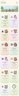

<!-- généré par scripts/catalogue_pages.py — ne pas éditer à la main -->

[Accueil](../index.md)

# Jeu opencadkid (page 5/5)

Dépôt : [opencadkid](../sources/opencadkid.md) · 1041 asset(s) employés (usages actifs de l'index d'usage)

Licences : [MIT](../licences/MIT.md) 22 · [unknown](../licences/unknown.md) 1019

Pages : [1](opencadkid.md) · [2](opencadkid-2.md) · [3](opencadkid-3.md) · [4](opencadkid-4.md) · **5**

| Vignette | Fiche | Nom | Catégorie | Licence | Auteur | Commits | Planche |
|---|---|---|---|---|---|---|---|
| — | [`asset-codegenerated-gouter-test-0001`](../../../catalog/assets/asset-codegenerated-gouter-test-0001.json) | gouter.test | codegenerated | [MIT](../licences/MIT.md) | unknown | `3bdf79f`, `41deaef`, `5d57bd8`, `69948ce` | — |
| — | [`asset-codegenerated-illustration-test-0001`](../../../catalog/assets/asset-codegenerated-illustration-test-0001.json) | illustration.test | codegenerated | [MIT](../licences/MIT.md) | unknown | `5d57bd8`, `69948ce` | — |
| — | [`asset-codegenerated-puzzle-test-0001`](../../../catalog/assets/asset-codegenerated-puzzle-test-0001.json) | puzzle.test | codegenerated | [MIT](../licences/MIT.md) | unknown | `0ffa445`, `1ab28cc`, `3213ebb`, `3bdf79f`, `3c4f0ca`, `40bb4c2`, `41deaef`, `490611b`, `56bb3e4`, `5d57bd8`, `69948ce`, `6e3bdf8`, `7164c38`, `740d6d8`, `9281c9c`, `92c2223`, `9b7c3cf`, `b06cca8`, `ba6417e`, `c2a9269`, `d1bd1ad`, `d7d0cd2`, `ded08e9`, `e47a807`, `e70d2ca` | — |
| — | [`asset-codegenerated-scenes-0001`](../../../catalog/assets/asset-codegenerated-scenes-0001.json) | scenes | codegenerated | [MIT](../licences/MIT.md) | unknown | `0ffa445`, `1ab28cc`, `3213ebb`, `3bdf79f`, `3c4f0ca`, `40bb4c2`, `41deaef`, `490611b`, `56bb3e4`, `5d57bd8`, `69948ce`, `6e3bdf8`, `7164c38`, `740d6d8`, `9281c9c`, `92c2223`, `9b7c3cf`, `b06cca8`, `ba6417e`, `c2a9269`, `d1bd1ad`, `d7d0cd2`, `ded08e9`, `e47a807`, `e70d2ca` | — |
| — | [`asset-audio-fr-fond-0001`](../../../catalog/assets/asset-audio-fr-fond-0001.json) | fr-fond | environments | [unknown](../licences/unknown.md) | unknown | `5d57bd8`, `69948ce` | — |
| — | [`asset-audio-fr-fond-phrase-0001`](../../../catalog/assets/asset-audio-fr-fond-phrase-0001.json) | fr-fond-phrase | environments | [unknown](../licences/unknown.md) | unknown | `5d57bd8`, `69948ce` | — |
|  | [`asset-image-atelier-fond-pinceau-0001`](../../../catalog/assets/asset-image-atelier-fond-pinceau-0001.json) | atelier-fond-pinceau | environments | [unknown](../licences/unknown.md) | unknown | `0ffa445`, `1ab28cc`, `3213ebb`, `3bdf79f`, `3c4f0ca`, `40bb4c2`, `41deaef`, `490611b`, `56bb3e4`, `5d57bd8`, `69948ce`, `6e3bdf8`, `7164c38`, `740d6d8`, `9281c9c`, `92c2223`, `9b7c3cf`, `b06cca8`, `ba6417e`, `c2a9269`, `c72f89b`, `d1bd1ad`, `d7d0cd2`, `d976e96`, `ded08e9`, `e47a807`, `e70d2ca` | — |
|  | [`asset-image-accueil-catalogue-0001`](../../../catalog/assets/asset-image-accueil-catalogue-0001.json) | accueil-catalogue | image | [unknown](../licences/unknown.md) | unknown | `0ffa445`, `1ab28cc`, `3213ebb`, `3bdf79f`, `3c4f0ca`, `40bb4c2`, `41deaef`, `490611b`, `56bb3e4`, `5d57bd8`, `69948ce`, `6e3bdf8`, `7164c38`, `740d6d8`, `9281c9c`, `92c2223`, `9b7c3cf`, `b06cca8`, `ba6417e`, `c2a9269`, `c483799`, `c72f89b`, `d1bd1ad`, `d7d0cd2`, `d976e96`, `ded08e9`, `e47a807`, `e70d2ca` | — |
|  | [`asset-image-accueil-en-0001`](../../../catalog/assets/asset-image-accueil-en-0001.json) | accueil-en | image | [unknown](../licences/unknown.md) | unknown | `0ffa445`, `1ab28cc`, `28d1731`, `3213ebb`, `3bdf79f`, `3c4f0ca`, `40bb4c2`, `41deaef`, `490611b`, `56bb3e4`, `5d57bd8`, `69948ce`, `6e3bdf8`, `7164c38`, `740d6d8`, `9281c9c`, `92c2223`, `9b7c3cf`, `b06cca8`, `ba6417e`, `c2a9269`, `c483799`, `c72f89b`, `d1bd1ad`, `d7d0cd2`, `d976e96`, `ded08e9`, `e47a807`, `e70d2ca` | — |
|  | [`asset-image-accueil-fr-0001`](../../../catalog/assets/asset-image-accueil-fr-0001.json) | accueil-fr | image | [unknown](../licences/unknown.md) | unknown | `0ffa445`, `1ab28cc`, `28d1731`, `3213ebb`, `3bdf79f`, `3c4f0ca`, `40bb4c2`, `41deaef`, `490611b`, `56bb3e4`, `5d57bd8`, `69948ce`, `6e3bdf8`, `7164c38`, `740d6d8`, `9281c9c`, `92c2223`, `9b7c3cf`, `b06cca8`, `ba6417e`, `c2a9269`, `c483799`, `c72f89b`, `d1bd1ad`, `d7d0cd2`, `d976e96`, `ded08e9`, `e47a807`, `e70d2ca` | — |
|  | [`asset-image-ardennes-0002`](../../../catalog/assets/asset-image-ardennes-0002.json) | ardennes | image | [MIT](../licences/MIT.md) | outil IA (ChatGPT) sur commande de David (horizons), recadrés en 5:4 par l'agent | `5d57bd8`, `69948ce` | — |
|  | [`asset-image-atelier-anime-0001`](../../../catalog/assets/asset-image-atelier-anime-0001.json) | atelier-anime | image | [unknown](../licences/unknown.md) | unknown | `0ffa445`, `1ab28cc`, `3213ebb`, `3bdf79f`, `3c4f0ca`, `40bb4c2`, `41deaef`, `490611b`, `56bb3e4`, `5d57bd8`, `69948ce`, `6e3bdf8`, `7164c38`, `740d6d8`, `9281c9c`, `92c2223`, `9b7c3cf`, `b06cca8`, `ba6417e`, `c2a9269`, `c72f89b`, `d1bd1ad`, `d7d0cd2`, `d976e96`, `ded08e9`, `e47a807`, `e70d2ca` | — |
|  | [`asset-image-atelier-coloriage-0001`](../../../catalog/assets/asset-image-atelier-coloriage-0001.json) | atelier-coloriage | image | [unknown](../licences/unknown.md) | unknown | `0ffa445`, `1ab28cc`, `3213ebb`, `3bdf79f`, `3c4f0ca`, `40bb4c2`, `41deaef`, `490611b`, `56bb3e4`, `5d57bd8`, `69948ce`, `6e3bdf8`, `7164c38`, `740d6d8`, `9281c9c`, `92c2223`, `9b7c3cf`, `b06cca8`, `ba6417e`, `c2a9269`, `c483799`, `c72f89b`, `d1bd1ad`, `d7d0cd2`, `d976e96`, `ded08e9`, `e47a807`, `e70d2ca` | — |
|  | [`asset-image-atelier-dessin-0001`](../../../catalog/assets/asset-image-atelier-dessin-0001.json) | atelier-dessin | image | [unknown](../licences/unknown.md) | unknown | `0ffa445`, `1ab28cc`, `3213ebb`, `3bdf79f`, `3c4f0ca`, `40bb4c2`, `41deaef`, `490611b`, `56bb3e4`, `5d57bd8`, `69948ce`, `6e3bdf8`, `7164c38`, `740d6d8`, `9281c9c`, `92c2223`, `9b7c3cf`, `b06cca8`, `ba6417e`, `c2a9269`, `c72f89b`, `d1bd1ad`, `d7d0cd2`, `d976e96`, `ded08e9`, `e47a807`, `e70d2ca` | — |
|  | [`asset-image-chemin-prairie-0001`](../../../catalog/assets/asset-image-chemin-prairie-0001.json) | chemin-prairie | image | [unknown](../licences/unknown.md) | unknown | `0ffa445`, `1ab28cc`, `28d1731`, `3213ebb`, `3bdf79f`, `3c4f0ca`, `40bb4c2`, `41deaef`, `490611b`, `56bb3e4`, `5d57bd8`, `69948ce`, `6e3bdf8`, `7164c38`, `740d6d8`, `9281c9c`, `92c2223`, `9b7c3cf`, `b06cca8`, `ba6417e`, `c2a9269`, `c483799`, `c72f89b`, `d1bd1ad`, `d7d0cd2`, `d976e96`, `ded08e9`, `e47a807`, `e70d2ca` | — |
|  | [`asset-image-compter-combien-0001`](../../../catalog/assets/asset-image-compter-combien-0001.json) | compter-combien | image | [unknown](../licences/unknown.md) | unknown | `0ffa445`, `1ab28cc`, `28d1731`, `3213ebb`, `3bdf79f`, `3c4f0ca`, `40bb4c2`, `41deaef`, `490611b`, `56bb3e4`, `5d57bd8`, `69948ce`, `6e3bdf8`, `7164c38`, `740d6d8`, `9281c9c`, `92c2223`, `9b7c3cf`, `b06cca8`, `ba6417e`, `c2a9269`, `c483799`, `c72f89b`, `d1bd1ad`, `d7d0cd2`, `d976e96`, `ded08e9`, `e47a807`, `e70d2ca` | — |
|  | [`asset-image-compter-etoiles-0001`](../../../catalog/assets/asset-image-compter-etoiles-0001.json) | compter-etoiles | image | [unknown](../licences/unknown.md) | unknown | `0ffa445`, `1ab28cc`, `28d1731`, `3213ebb`, `3bdf79f`, `3c4f0ca`, `40bb4c2`, `41deaef`, `490611b`, `56bb3e4`, `5d57bd8`, `69948ce`, `6e3bdf8`, `7164c38`, `740d6d8`, `9281c9c`, `92c2223`, `9b7c3cf`, `b06cca8`, `ba6417e`, `c2a9269`, `c483799`, `c72f89b`, `d1bd1ad`, `d7d0cd2`, `d976e96`, `ded08e9`, `e47a807`, `e70d2ca` | — |
|  | [`asset-image-compter-remplir-0001`](../../../catalog/assets/asset-image-compter-remplir-0001.json) | compter-remplir | image | [unknown](../licences/unknown.md) | unknown | `0ffa445`, `1ab28cc`, `28d1731`, `3213ebb`, `3bdf79f`, `3c4f0ca`, `40bb4c2`, `41deaef`, `490611b`, `56bb3e4`, `5d57bd8`, `69948ce`, `6e3bdf8`, `7164c38`, `740d6d8`, `9281c9c`, `92c2223`, `9b7c3cf`, `b06cca8`, `ba6417e`, `c2a9269`, `c483799`, `c72f89b`, `d1bd1ad`, `d7d0cd2`, `d976e96`, `ded08e9`, `e47a807`, `e70d2ca` | — |
|  | [`asset-image-formes-trier-0001`](../../../catalog/assets/asset-image-formes-trier-0001.json) | formes-trier | image | [unknown](../licences/unknown.md) | unknown | `0ffa445`, `1ab28cc`, `28d1731`, `3213ebb`, `3bdf79f`, `3c4f0ca`, `40bb4c2`, `41deaef`, `490611b`, `56bb3e4`, `5d57bd8`, `69948ce`, `6e3bdf8`, `7164c38`, `740d6d8`, `9281c9c`, `92c2223`, `9b7c3cf`, `b06cca8`, `ba6417e`, `c2a9269`, `c483799`, `c72f89b`, `d1bd1ad`, `d7d0cd2`, `d976e96`, `ded08e9`, `e47a807`, `e70d2ca` | — |
|  | [`asset-image-galaxy-0002`](../../../catalog/assets/asset-image-galaxy-0002.json) | galaxy | image | [MIT](../licences/MIT.md) | outil IA (ChatGPT) sur commande de David (horizons), recadrés en 5:4 par l'agent | `5d57bd8`, `69948ce` | — |
|  | [`asset-image-gouter-miam-0001`](../../../catalog/assets/asset-image-gouter-miam-0001.json) | gouter-miam | image | [unknown](../licences/unknown.md) | unknown | `0ffa445`, `1ab28cc`, `3213ebb`, `3bdf79f`, `3c4f0ca`, `40bb4c2`, `41deaef`, `490611b`, `56bb3e4`, `5d57bd8`, `69948ce`, `6e3bdf8`, `7164c38`, `740d6d8`, `9281c9c`, `92c2223`, `9b7c3cf`, `b06cca8`, `ba6417e`, `c2a9269`, `c72f89b`, `d1bd1ad`, `d7d0cd2`, `d976e96`, `ded08e9`, `e47a807`, `e70d2ca` | — |
|  | [`asset-image-islands-0002`](../../../catalog/assets/asset-image-islands-0002.json) | islands | image | [MIT](../licences/MIT.md) | outil IA (ChatGPT) sur commande de David (horizons), recadrés en 5:4 par l'agent | `5d57bd8`, `69948ce` | — |
|  | [`asset-image-opencade-0002`](../../../catalog/assets/asset-image-opencade-0002.json) | opencade | image | [MIT](../licences/MIT.md) | code / agent | `0ffa445`, `1ab28cc`, `3213ebb`, `3bdf79f`, `3c4f0ca`, `40bb4c2`, `41deaef`, `490611b`, `56bb3e4`, `5d57bd8`, `69948ce`, `6e3bdf8`, `7164c38`, `740d6d8`, `9281c9c`, `92c2223`, `9b7c3cf`, `b06cca8`, `ba6417e`, `c2a9269`, `c72f89b`, `d1bd1ad`, `d7d0cd2`, `ded08e9`, `e47a807`, `e70d2ca` | — |
|  | [`asset-image-paires-plateau-0001`](../../../catalog/assets/asset-image-paires-plateau-0001.json) | paires-plateau | image | [unknown](../licences/unknown.md) | unknown | `0ffa445`, `1ab28cc`, `28d1731`, `3213ebb`, `3bdf79f`, `3c4f0ca`, `40bb4c2`, `41deaef`, `490611b`, `56bb3e4`, `5d57bd8`, `69948ce`, `6e3bdf8`, `7164c38`, `740d6d8`, `9281c9c`, `92c2223`, `9b7c3cf`, `b06cca8`, `ba6417e`, `c2a9269`, `c483799`, `c72f89b`, `d1bd1ad`, `d7d0cd2`, `d976e96`, `ded08e9`, `e47a807`, `e70d2ca` | — |
|  | [`asset-image-panneau-0002`](../../../catalog/assets/asset-image-panneau-0002.json) | panneau | image | [MIT](../licences/MIT.md) | outil IA (ChatGPT) sur commande de David (panneau directionnel de Pistouille), recadré par l'agent | `3bdf79f`, `5d57bd8`, `69948ce`, `7164c38` | — |
|  | [`asset-image-petit-astronome-0002`](../../../catalog/assets/asset-image-petit-astronome-0002.json) | petit-astronome | image | [MIT](../licences/MIT.md) | code / agent | `5d57bd8` | — |
|  | [`asset-image-petit-astronome-0003`](../../../catalog/assets/asset-image-petit-astronome-0003.json) | petit-astronome | image | [unknown](../licences/unknown.md) | unknown | `0ffa445`, `1ab28cc`, `3213ebb`, `3bdf79f`, `3c4f0ca`, `40bb4c2`, `41deaef`, `490611b`, `56bb3e4`, `5d57bd8`, `69948ce`, `6e3bdf8`, `7164c38`, `740d6d8`, `9281c9c`, `92c2223`, `9b7c3cf`, `b06cca8`, `ba6417e`, `c2a9269`, `c72f89b`, `d1bd1ad`, `d7d0cd2`, `ded08e9`, `e47a807`, `e70d2ca` | — |
|  | [`asset-image-puzzle-chateau-0001`](../../../catalog/assets/asset-image-puzzle-chateau-0001.json) | puzzle-chateau | image | [unknown](../licences/unknown.md) | unknown | `0ffa445`, `1ab28cc`, `28d1731`, `3213ebb`, `3bdf79f`, `3c4f0ca`, `40bb4c2`, `41deaef`, `490611b`, `56bb3e4`, `5d57bd8`, `69948ce`, `6e3bdf8`, `7164c38`, `740d6d8`, `9281c9c`, `92c2223`, `9b7c3cf`, `b06cca8`, `ba6417e`, `c2a9269`, `c483799`, `c72f89b`, `d1bd1ad`, `d7d0cd2`, `d976e96`, `ded08e9`, `e47a807`, `e70d2ca` | — |
|  | [`asset-image-sons-image-lettre-0001`](../../../catalog/assets/asset-image-sons-image-lettre-0001.json) | sons-image-lettre | image | [unknown](../licences/unknown.md) | unknown | `0ffa445`, `1ab28cc`, `28d1731`, `3213ebb`, `3bdf79f`, `3c4f0ca`, `40bb4c2`, `41deaef`, `490611b`, `56bb3e4`, `5d57bd8`, `69948ce`, `6e3bdf8`, `7164c38`, `740d6d8`, `9281c9c`, `92c2223`, `9b7c3cf`, `b06cca8`, `ba6417e`, `c2a9269`, `c483799`, `c72f89b`, `d1bd1ad`, `d7d0cd2`, `d976e96`, `ded08e9`, `e47a807`, `e70d2ca` | — |
|  | [`asset-image-tambours-ecoute-0001`](../../../catalog/assets/asset-image-tambours-ecoute-0001.json) | tambours-ecoute | image | [unknown](../licences/unknown.md) | unknown | `0ffa445`, `1ab28cc`, `3213ebb`, `3bdf79f`, `3c4f0ca`, `40bb4c2`, `41deaef`, `490611b`, `56bb3e4`, `5d57bd8`, `69948ce`, `6e3bdf8`, `7164c38`, `740d6d8`, `9281c9c`, `92c2223`, `9b7c3cf`, `b06cca8`, `ba6417e`, `c2a9269`, `c483799`, `c72f89b`, `d1bd1ad`, `d7d0cd2`, `d976e96`, `ded08e9`, `e47a807`, `e70d2ca` | — |
|  | [`asset-image-tictac-0003`](../../../catalog/assets/asset-image-tictac-0003.json) | tictac | image | [MIT](../licences/MIT.md) | code / agent | `0ffa445`, `1ab28cc`, `3213ebb`, `3bdf79f`, `3c4f0ca`, `40bb4c2`, `41deaef`, `490611b`, `56bb3e4`, `5d57bd8`, `69948ce`, `6e3bdf8`, `7164c38`, `740d6d8`, `9281c9c`, `92c2223`, `9b7c3cf`, `b06cca8`, `ba6417e`, `c2a9269`, `c72f89b`, `d1bd1ad`, `d7d0cd2`, `ded08e9`, `e47a807`, `e70d2ca` | — |
|  | [`asset-image-valley-0002`](../../../catalog/assets/asset-image-valley-0002.json) | valley | image | [MIT](../licences/MIT.md) | outil IA (ChatGPT) sur commande de David (horizons), recadrés en 5:4 par l'agent | `5d57bd8`, `69948ce` | — |
|  | [`asset-image-volcano-0002`](../../../catalog/assets/asset-image-volcano-0002.json) | volcano | image | [MIT](../licences/MIT.md) | outil IA (ChatGPT) sur commande de David (horizons), recadrés en 5:4 par l'agent | `5d57bd8`, `69948ce` | — |
|  | [`asset-image-zen-0002`](../../../catalog/assets/asset-image-zen-0002.json) | zen | image | [MIT](../licences/MIT.md) | outil IA (ChatGPT) sur commande de David (horizons), recadrés en 5:4 par l'agent | `5d57bd8`, `69948ce` | — |
| — | [`asset-style-style-0010`](../../../catalog/assets/asset-style-style-0010.json) | style | style | [unknown](../licences/unknown.md) | unknown | `0ffa445`, `1ab28cc`, `28d1731`, `3213ebb`, `3bdf79f`, `3c4f0ca`, `40bb4c2`, `41deaef`, `490611b`, `56bb3e4`, `5d57bd8`, `69948ce`, `6e3bdf8`, `7164c38`, `740d6d8`, `9281c9c`, `92c2223`, `9b7c3cf`, `b06cca8`, `ba6417e`, `c2a9269`, `c483799`, `c72f89b`, `d1bd1ad`, `d7d0cd2`, `d976e96`, `ded08e9`, `e47a807`, `e70d2ca` | — |
| — | [`asset-codegenerated-backdrops-0001`](../../../catalog/assets/asset-codegenerated-backdrops-0001.json) | backdrops | ui | [MIT](../licences/MIT.md) | unknown | `5d57bd8` | — |
| — | [`asset-codegenerated-illustration-0001`](../../../catalog/assets/asset-codegenerated-illustration-0001.json) | illustration | ui | [MIT](../licences/MIT.md) | unknown | `5d57bd8`, `69948ce` | — |
| — | [`asset-codegenerated-svg-0002`](../../../catalog/assets/asset-codegenerated-svg-0002.json) | svg | ui | [MIT](../licences/MIT.md) | unknown | `5d57bd8` | — |
|  | [`asset-image-opencadkid-192-0002`](../../../catalog/assets/asset-image-opencadkid-192-0002.json) | opencadkid-192 | ui | [MIT](../licences/MIT.md) | Davy45270 (icônes dessinées par le code de opencadkid) | `0ffa445`, `1ab28cc`, `28d1731`, `3213ebb`, `3bdf79f`, `3c4f0ca`, `40bb4c2`, `41deaef`, `490611b`, `56bb3e4`, `5d57bd8`, `69948ce`, `6e3bdf8`, `7164c38`, `740d6d8`, `9281c9c`, `92c2223`, `9b7c3cf`, `b06cca8`, `ba6417e`, `c2a9269`, `c483799`, `c72f89b`, `d1bd1ad`, `d7d0cd2`, `d976e96`, `ded08e9`, `e47a807`, `e70d2ca` | — |
|  | [`asset-image-opencadkid-512-0002`](../../../catalog/assets/asset-image-opencadkid-512-0002.json) | opencadkid-512 | ui | [MIT](../licences/MIT.md) | Davy45270 (icônes dessinées par le code de opencadkid) | `0ffa445`, `1ab28cc`, `28d1731`, `3213ebb`, `3bdf79f`, `3c4f0ca`, `40bb4c2`, `41deaef`, `490611b`, `56bb3e4`, `5d57bd8`, `69948ce`, `6e3bdf8`, `7164c38`, `740d6d8`, `9281c9c`, `92c2223`, `9b7c3cf`, `b06cca8`, `ba6417e`, `c2a9269`, `c483799`, `c72f89b`, `d1bd1ad`, `d7d0cd2`, `d976e96`, `ded08e9`, `e47a807`, `e70d2ca` | — |
|  | [`asset-image-tictac-0001`](../../../catalog/assets/asset-image-tictac-0001.json) | tictac | ui | [MIT](../licences/MIT.md) | code / agent | `5d57bd8` | — |
