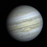
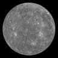
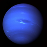
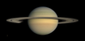
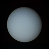
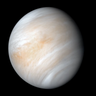

<!-- généré par scripts/catalogue_pages.py — ne pas éditer à la main -->

[Accueil](../index.md)

# Jeu petit-astronome

Dépôt : [petit-astronome](../sources/petit-astronome.md) · 22 asset(s) employés (usages actifs de l'index d'usage)

Licences : [LicenseRef-JPL-Image-Use-Policy](../licences/LicenseRef-JPL-Image-Use-Policy.md) 6 · [LicenseRef-MESSENGER-Usage-Statement](../licences/LicenseRef-MESSENGER-Usage-Statement.md) 1 · [LicenseRef-NASA-Media-Usage-Guidelines](../licences/LicenseRef-NASA-Media-Usage-Guidelines.md) 1 · [MIT](../licences/MIT.md) 13 · [unknown](../licences/unknown.md) 1

| Vignette | Fiche | Nom | Catégorie | Licence | Auteur | Commits | Planche |
|---|---|---|---|---|---|---|---|
|  | [`asset-image-jupiter-0001`](../../../catalog/assets/asset-image-jupiter-0001.json) | jupiter | image | [LicenseRef-JPL-Image-Use-Policy](../licences/LicenseRef-JPL-Image-Use-Policy.md) | NASA/JPL | `d7b66b9` | — |
|  | [`asset-image-mars-0001`](../../../catalog/assets/asset-image-mars-0001.json) | mars | image | [LicenseRef-JPL-Image-Use-Policy](../licences/LicenseRef-JPL-Image-Use-Policy.md) | NASA/JPL-Caltech/USGS | `d7b66b9` | — |
|  | [`asset-image-mercure-0001`](../../../catalog/assets/asset-image-mercure-0001.json) | mercure | image | [LicenseRef-MESSENGER-Usage-Statement](../licences/LicenseRef-MESSENGER-Usage-Statement.md) | NASA/Johns Hopkins University Applied Physics Laboratory/Carnegie Institution of Washington | `d7b66b9` | — |
|  | [`asset-image-neptune-0001`](../../../catalog/assets/asset-image-neptune-0001.json) | neptune | image | [LicenseRef-JPL-Image-Use-Policy](../licences/LicenseRef-JPL-Image-Use-Policy.md) | NASA/JPL | `d7b66b9` | — |
|  | [`asset-image-opencade-0003`](../../../catalog/assets/asset-image-opencade-0003.json) | opencade | image | [MIT](../licences/MIT.md) | code / agent | `d7b66b9` | — |
|  | [`asset-image-opencadkid-0003`](../../../catalog/assets/asset-image-opencadkid-0003.json) | opencadkid | image | [MIT](../licences/MIT.md) | code / agent | `d7b66b9` | — |
|  | [`asset-image-saturne-0001`](../../../catalog/assets/asset-image-saturne-0001.json) | saturne | image | [LicenseRef-JPL-Image-Use-Policy](../licences/LicenseRef-JPL-Image-Use-Policy.md) | NASA/JPL/Space Science Institute | `d7b66b9` | — |
|  | [`asset-image-terre-0001`](../../../catalog/assets/asset-image-terre-0001.json) | terre | image | [LicenseRef-NASA-Media-Usage-Guidelines](../licences/LicenseRef-NASA-Media-Usage-Guidelines.md) | NASA Johnson Space Center | `d7b66b9` | — |
|  | [`asset-image-tictac-0004`](../../../catalog/assets/asset-image-tictac-0004.json) | tictac | image | [MIT](../licences/MIT.md) | code / agent | `d7b66b9` | — |
|  | [`asset-image-uranus-0001`](../../../catalog/assets/asset-image-uranus-0001.json) | uranus | image | [LicenseRef-JPL-Image-Use-Policy](../licences/LicenseRef-JPL-Image-Use-Policy.md) | NASA/JPL | `d7b66b9` | — |
|  | [`asset-image-venus-0001`](../../../catalog/assets/asset-image-venus-0001.json) | venus | image | [LicenseRef-JPL-Image-Use-Policy](../licences/LicenseRef-JPL-Image-Use-Policy.md) | NASA/JPL-Caltech | `d7b66b9` | — |
| — | [`asset-codegenerated-app-0001`](../../../catalog/assets/asset-codegenerated-app-0001.json) | app | ui | [MIT](../licences/MIT.md) | unknown | `d7b66b9` | — |
| — | [`asset-codegenerated-art-0019`](../../../catalog/assets/asset-codegenerated-art-0019.json) | art | ui | [MIT](../licences/MIT.md) | unknown | `d7b66b9` | — |
| — | [`asset-codegenerated-discovery-0001`](../../../catalog/assets/asset-codegenerated-discovery-0001.json) | discovery | ui | [MIT](../licences/MIT.md) | unknown | `d7b66b9` | — |
| — | [`asset-codegenerated-mascot-0001`](../../../catalog/assets/asset-codegenerated-mascot-0001.json) | mascot | ui | [MIT](../licences/MIT.md) | unknown | `d7b66b9` | — |
|  | [`asset-image-astro-192-0001`](../../../catalog/assets/asset-image-astro-192-0001.json) | astro-192 | ui | [MIT](../licences/MIT.md) | Davy45270 (icônes dessinées par scripts/make-icons.js du jeu) | `d7b66b9` | — |
|  | [`asset-image-astro-512-0001`](../../../catalog/assets/asset-image-astro-512-0001.json) | astro-512 | ui | [MIT](../licences/MIT.md) | Davy45270 (icônes dessinées par scripts/make-icons.js du jeu) | `d7b66b9` | — |
|  | [`asset-image-astro-maskable-512-0001`](../../../catalog/assets/asset-image-astro-maskable-512-0001.json) | astro-maskable-512 | ui | [MIT](../licences/MIT.md) | Davy45270 (icônes dessinées par scripts/make-icons.js du jeu) | `d7b66b9` | — |
|  | [`asset-image-opencade-0001`](../../../catalog/assets/asset-image-opencade-0001.json) | opencade | ui | [MIT](../licences/MIT.md) | code / agent | `d7b66b9` | — |
|  | [`asset-image-opencadkid-0001`](../../../catalog/assets/asset-image-opencadkid-0001.json) | opencadkid | ui | [MIT](../licences/MIT.md) | code / agent | `d7b66b9` | — |
|  | [`asset-image-tictac-0001`](../../../catalog/assets/asset-image-tictac-0001.json) | tictac | ui | [MIT](../licences/MIT.md) | code / agent | `d7b66b9` | — |
| — | [`asset-style-style-0012`](../../../catalog/assets/asset-style-style-0012.json) | style | ui | [unknown](../licences/unknown.md) | unknown | `381942d`, `66baef4`, `d7b66b9` | — |
