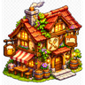

<!-- généré par scripts/catalogue_pages.py — ne pas éditer à la main -->

[Accueil](../index.md)

# Planche Auberge

Licence : [CC-BY-SA-4.0](../licences/CC-BY-SA-4.0.md) · auteur : Davy45270 (dessin fourni par David ; auteur ou outil de création non déclaré) · 1536×1024 · SHA-256 `56bc56453cdd`

Fiche : [`sheet-auberge-0001`](../../../catalog/sheets/sheet-auberge-0001.json)

1 asset(s) découpés de cette planche.

| Vignette | Fiche | Nom | Catégorie | Licence | Auteur | Jeux | Planche |
|---|---|---|---|---|---|---|---|
|  | [`asset-sprite-auberge-0001`](../../../catalog/assets/asset-sprite-auberge-0001.json) | auberge | sprite | [CC-BY-SA-4.0](../licences/CC-BY-SA-4.0.md) | Davy45270 (dessin fourni par David ; auteur ou outil de création non déclaré) | — | [sheet-auberge-0001](../planches/sheet-auberge-0001.md) |
