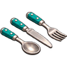
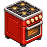
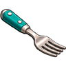
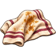
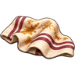
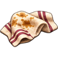
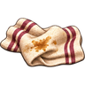

<!-- généré par scripts/catalogue_pages.py — ne pas éditer à la main -->

[Accueil](../index.md)

# Planche cuisine-culinaires-detouree

Licence : [unknown](../licences/unknown.md) · auteur : David (commanditaire) ; image générée par ChatGPT (OpenAI) · 1536×1024 · SHA-256 `35a479d5a8c3`

Fiche : [`sheet-cuisine-culinaires-detouree-0001`](../../../catalog/sheets/sheet-cuisine-culinaires-detouree-0001.json)

16 asset(s) découpés de cette planche.

| Vignette | Fiche | Nom | Catégorie | Licence | Auteur | Jeux | Planche |
|---|---|---|---|---|---|---|---|
|  | [`asset-sprite-cuisine-couverts-vue-1-0001`](../../../catalog/assets/asset-sprite-cuisine-couverts-vue-1-0001.json) | cuisine-couverts-vue-1 | kitchen | [CC0-1.0](../licences/CC0-1.0.md) | David (commanditaire) ; image générée par ChatGPT (OpenAI) | — | [sheet-cuisine-culinaires-detouree-0001](../planches/sheet-cuisine-culinaires-detouree-0001.md) |
|  | [`asset-sprite-cuisine-couverts-vue-2-0001`](../../../catalog/assets/asset-sprite-cuisine-couverts-vue-2-0001.json) | cuisine-couverts-vue-2 | kitchen | [CC0-1.0](../licences/CC0-1.0.md) | David (commanditaire) ; image générée par ChatGPT (OpenAI) | — | [sheet-cuisine-culinaires-detouree-0001](../planches/sheet-cuisine-culinaires-detouree-0001.md) |
|  | [`asset-sprite-cuisine-couverts-vue-3-0001`](../../../catalog/assets/asset-sprite-cuisine-couverts-vue-3-0001.json) | cuisine-couverts-vue-3 | kitchen | [CC0-1.0](../licences/CC0-1.0.md) | David (commanditaire) ; image générée par ChatGPT (OpenAI) | — | [sheet-cuisine-culinaires-detouree-0001](../planches/sheet-cuisine-culinaires-detouree-0001.md) |
|  | [`asset-sprite-cuisine-couverts-vue-4-0001`](../../../catalog/assets/asset-sprite-cuisine-couverts-vue-4-0001.json) | cuisine-couverts-vue-4 | kitchen | [CC0-1.0](../licences/CC0-1.0.md) | David (commanditaire) ; image générée par ChatGPT (OpenAI) | — | [sheet-cuisine-culinaires-detouree-0001](../planches/sheet-cuisine-culinaires-detouree-0001.md) |
|  | [`asset-sprite-cuisine-cuisiniere-vue-1-0001`](../../../catalog/assets/asset-sprite-cuisine-cuisiniere-vue-1-0001.json) | cuisine-cuisiniere-vue-1 | kitchen | [CC0-1.0](../licences/CC0-1.0.md) | David (commanditaire) ; image générée par ChatGPT (OpenAI) | — | [sheet-cuisine-culinaires-detouree-0001](../planches/sheet-cuisine-culinaires-detouree-0001.md) |
|  | [`asset-sprite-cuisine-cuisiniere-vue-2-0001`](../../../catalog/assets/asset-sprite-cuisine-cuisiniere-vue-2-0001.json) | cuisine-cuisiniere-vue-2 | kitchen | [CC0-1.0](../licences/CC0-1.0.md) | David (commanditaire) ; image générée par ChatGPT (OpenAI) | — | [sheet-cuisine-culinaires-detouree-0001](../planches/sheet-cuisine-culinaires-detouree-0001.md) |
|  | [`asset-sprite-cuisine-cuisiniere-vue-3-0001`](../../../catalog/assets/asset-sprite-cuisine-cuisiniere-vue-3-0001.json) | cuisine-cuisiniere-vue-3 | kitchen | [CC0-1.0](../licences/CC0-1.0.md) | David (commanditaire) ; image générée par ChatGPT (OpenAI) | — | [sheet-cuisine-culinaires-detouree-0001](../planches/sheet-cuisine-culinaires-detouree-0001.md) |
|  | [`asset-sprite-cuisine-cuisiniere-vue-4-0001`](../../../catalog/assets/asset-sprite-cuisine-cuisiniere-vue-4-0001.json) | cuisine-cuisiniere-vue-4 | kitchen | [CC0-1.0](../licences/CC0-1.0.md) | David (commanditaire) ; image générée par ChatGPT (OpenAI) | — | [sheet-cuisine-culinaires-detouree-0001](../planches/sheet-cuisine-culinaires-detouree-0001.md) |
|  | [`asset-sprite-cuisine-fourchette-vue-1-0001`](../../../catalog/assets/asset-sprite-cuisine-fourchette-vue-1-0001.json) | cuisine-fourchette-vue-1 | kitchen | [CC0-1.0](../licences/CC0-1.0.md) | David (commanditaire) ; image générée par ChatGPT (OpenAI) | — | [sheet-cuisine-culinaires-detouree-0001](../planches/sheet-cuisine-culinaires-detouree-0001.md) |
|  | [`asset-sprite-cuisine-fourchette-vue-2-0001`](../../../catalog/assets/asset-sprite-cuisine-fourchette-vue-2-0001.json) | cuisine-fourchette-vue-2 | kitchen | [CC0-1.0](../licences/CC0-1.0.md) | David (commanditaire) ; image générée par ChatGPT (OpenAI) | — | [sheet-cuisine-culinaires-detouree-0001](../planches/sheet-cuisine-culinaires-detouree-0001.md) |
|  | [`asset-sprite-cuisine-fourchette-vue-3-0001`](../../../catalog/assets/asset-sprite-cuisine-fourchette-vue-3-0001.json) | cuisine-fourchette-vue-3 | kitchen | [CC0-1.0](../licences/CC0-1.0.md) | David (commanditaire) ; image générée par ChatGPT (OpenAI) | — | [sheet-cuisine-culinaires-detouree-0001](../planches/sheet-cuisine-culinaires-detouree-0001.md) |
|  | [`asset-sprite-cuisine-fourchette-vue-4-0001`](../../../catalog/assets/asset-sprite-cuisine-fourchette-vue-4-0001.json) | cuisine-fourchette-vue-4 | kitchen | [CC0-1.0](../licences/CC0-1.0.md) | David (commanditaire) ; image générée par ChatGPT (OpenAI) | — | [sheet-cuisine-culinaires-detouree-0001](../planches/sheet-cuisine-culinaires-detouree-0001.md) |
|  | [`asset-sprite-cuisine-torchon-vue-1-0001`](../../../catalog/assets/asset-sprite-cuisine-torchon-vue-1-0001.json) | cuisine-torchon-vue-1 | kitchen | [CC0-1.0](../licences/CC0-1.0.md) | David (commanditaire) ; image générée par ChatGPT (OpenAI) | — | [sheet-cuisine-culinaires-detouree-0001](../planches/sheet-cuisine-culinaires-detouree-0001.md) |
|  | [`asset-sprite-cuisine-torchon-vue-2-0001`](../../../catalog/assets/asset-sprite-cuisine-torchon-vue-2-0001.json) | cuisine-torchon-vue-2 | kitchen | [CC0-1.0](../licences/CC0-1.0.md) | David (commanditaire) ; image générée par ChatGPT (OpenAI) | — | [sheet-cuisine-culinaires-detouree-0001](../planches/sheet-cuisine-culinaires-detouree-0001.md) |
|  | [`asset-sprite-cuisine-torchon-vue-3-0001`](../../../catalog/assets/asset-sprite-cuisine-torchon-vue-3-0001.json) | cuisine-torchon-vue-3 | kitchen | [CC0-1.0](../licences/CC0-1.0.md) | David (commanditaire) ; image générée par ChatGPT (OpenAI) | — | [sheet-cuisine-culinaires-detouree-0001](../planches/sheet-cuisine-culinaires-detouree-0001.md) |
|  | [`asset-sprite-cuisine-torchon-vue-4-0001`](../../../catalog/assets/asset-sprite-cuisine-torchon-vue-4-0001.json) | cuisine-torchon-vue-4 | kitchen | [CC0-1.0](../licences/CC0-1.0.md) | David (commanditaire) ; image générée par ChatGPT (OpenAI) | — | [sheet-cuisine-culinaires-detouree-0001](../planches/sheet-cuisine-culinaires-detouree-0001.md) |
