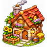

<!-- généré par scripts/catalogue_pages.py — ne pas éditer à la main -->

[Accueil](../index.md)

# Planche Maison de paysan

Licence : [CC-BY-SA-4.0](../licences/CC-BY-SA-4.0.md) · auteur : Davy45270 (dessin fourni par David ; auteur ou outil de création non déclaré) · 1536×1024 · SHA-256 `e1880c97f5fa`

Fiche : [`sheet-maison-paysan-0001`](../../../catalog/sheets/sheet-maison-paysan-0001.json)

3 asset(s) découpés de cette planche.

| Vignette | Fiche | Nom | Catégorie | Licence | Auteur | Jeux | Planche |
|---|---|---|---|---|---|---|---|
|  | [`asset-sprite-maison-paysan-0001`](../../../catalog/assets/asset-sprite-maison-paysan-0001.json) | maison-paysan | sprite | [CC-BY-SA-4.0](../licences/CC-BY-SA-4.0.md) | Davy45270 (dessin fourni par David ; auteur ou outil de création non déclaré) | — | [sheet-maison-paysan-0001](../planches/sheet-maison-paysan-0001.md) |
|  | [`asset-sprite-sprite-maison-paysan-0001`](../../../catalog/assets/asset-sprite-sprite-maison-paysan-0001.json) | sprite-maison-paysan | sprite | [unknown](../licences/unknown.md) | unknown | [pestouille-rpg](../jeux/pestouille-rpg.md) | [sheet-maison-paysan-0001](../planches/sheet-maison-paysan-0001.md) |
|  | [`asset-sprite-sprite-maison-paysan-0002`](../../../catalog/assets/asset-sprite-sprite-maison-paysan-0002.json) | sprite-maison-paysan | sprite | [unknown](../licences/unknown.md) | unknown | [pestouille-rpg](../jeux/pestouille-rpg.md) | [sheet-maison-paysan-0001](../planches/sheet-maison-paysan-0001.md) |
