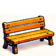
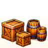
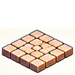
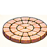

<!-- généré par scripts/catalogue_pages.py — ne pas éditer à la main -->

[Accueil](../index.md)

# Planche Place du village

Licence : [CC-BY-SA-4.0](../licences/CC-BY-SA-4.0.md) · auteur : Davy45270 (dessin fourni par David ; auteur ou outil de création non déclaré) · 1536×1024 · SHA-256 `99e83735e99a`

Fiche : [`sheet-place-village-0001`](../../../catalog/sheets/sheet-place-village-0001.json)

13 asset(s) découpés de cette planche.

| Vignette | Fiche | Nom | Catégorie | Licence | Auteur | Jeux | Planche |
|---|---|---|---|---|---|---|---|
|  | [`asset-sprite-banc-0001`](../../../catalog/assets/asset-sprite-banc-0001.json) | banc | sprite | [CC-BY-SA-4.0](../licences/CC-BY-SA-4.0.md) | Davy45270 (dessin fourni par David ; auteur ou outil de création non déclaré) | — | [sheet-place-village-0001](../planches/sheet-place-village-0001.md) |
|  | [`asset-sprite-banniere-bleue-0001`](../../../catalog/assets/asset-sprite-banniere-bleue-0001.json) | banniere-bleue | sprite | [CC-BY-SA-4.0](../licences/CC-BY-SA-4.0.md) | Davy45270 (dessin fourni par David ; auteur ou outil de création non déclaré) | — | [sheet-place-village-0001](../planches/sheet-place-village-0001.md) |
|  | [`asset-sprite-banniere-rouge-0001`](../../../catalog/assets/asset-sprite-banniere-rouge-0001.json) | banniere-rouge | sprite | [CC-BY-SA-4.0](../licences/CC-BY-SA-4.0.md) | Davy45270 (dessin fourni par David ; auteur ou outil de création non déclaré) | — | [sheet-place-village-0001](../planches/sheet-place-village-0001.md) |
|  | [`asset-sprite-caisses-0001`](../../../catalog/assets/asset-sprite-caisses-0001.json) | caisses | sprite | [CC-BY-SA-4.0](../licences/CC-BY-SA-4.0.md) | Davy45270 (dessin fourni par David ; auteur ou outil de création non déclaré) | — | [sheet-place-village-0001](../planches/sheet-place-village-0001.md) |
|  | [`asset-sprite-dalle-carree-0001`](../../../catalog/assets/asset-sprite-dalle-carree-0001.json) | dalle-carree | sprite | [CC-BY-SA-4.0](../licences/CC-BY-SA-4.0.md) | Davy45270 (dessin fourni par David ; auteur ou outil de création non déclaré) | — | [sheet-place-village-0001](../planches/sheet-place-village-0001.md) |
|  | [`asset-sprite-dalle-ronde-0001`](../../../catalog/assets/asset-sprite-dalle-ronde-0001.json) | dalle-ronde | sprite | [CC-BY-SA-4.0](../licences/CC-BY-SA-4.0.md) | Davy45270 (dessin fourni par David ; auteur ou outil de création non déclaré) | — | [sheet-place-village-0001](../planches/sheet-place-village-0001.md) |
|  | [`asset-sprite-etal-0001`](../../../catalog/assets/asset-sprite-etal-0001.json) | etal | sprite | [CC-BY-SA-4.0](../licences/CC-BY-SA-4.0.md) | Davy45270 (dessin fourni par David ; auteur ou outil de création non déclaré) | — | [sheet-place-village-0001](../planches/sheet-place-village-0001.md) |
|  | [`asset-sprite-fontaine-0001`](../../../catalog/assets/asset-sprite-fontaine-0001.json) | fontaine | sprite | [CC-BY-SA-4.0](../licences/CC-BY-SA-4.0.md) | Davy45270 (dessin fourni par David ; auteur ou outil de création non déclaré) | — | [sheet-place-village-0001](../planches/sheet-place-village-0001.md) |
|  | [`asset-sprite-lanterne-0002`](../../../catalog/assets/asset-sprite-lanterne-0002.json) | lanterne | sprite | [CC-BY-SA-4.0](../licences/CC-BY-SA-4.0.md) | Davy45270 (dessin fourni par David ; auteur ou outil de création non déclaré) | — | [sheet-place-village-0001](../planches/sheet-place-village-0001.md) |
|  | [`asset-sprite-panneau-affichage-0001`](../../../catalog/assets/asset-sprite-panneau-affichage-0001.json) | panneau-affichage | sprite | [CC-BY-SA-4.0](../licences/CC-BY-SA-4.0.md) | Davy45270 (dessin fourni par David ; auteur ou outil de création non déclaré) | — | [sheet-place-village-0001](../planches/sheet-place-village-0001.md) |
|  | [`asset-sprite-panneau-indicateur-0001`](../../../catalog/assets/asset-sprite-panneau-indicateur-0001.json) | panneau-indicateur | sprite | [CC-BY-SA-4.0](../licences/CC-BY-SA-4.0.md) | Davy45270 (dessin fourni par David ; auteur ou outil de création non déclaré) | — | [sheet-place-village-0001](../planches/sheet-place-village-0001.md) |
|  | [`asset-sprite-pot-fleurs-blanc-0001`](../../../catalog/assets/asset-sprite-pot-fleurs-blanc-0001.json) | pot-fleurs-blanc | sprite | [CC-BY-SA-4.0](../licences/CC-BY-SA-4.0.md) | Davy45270 (dessin fourni par David ; auteur ou outil de création non déclaré) | — | [sheet-place-village-0001](../planches/sheet-place-village-0001.md) |
|  | [`asset-sprite-pot-fleurs-rose-0001`](../../../catalog/assets/asset-sprite-pot-fleurs-rose-0001.json) | pot-fleurs-rose | sprite | [CC-BY-SA-4.0](../licences/CC-BY-SA-4.0.md) | Davy45270 (dessin fourni par David ; auteur ou outil de création non déclaré) | — | [sheet-place-village-0001](../planches/sheet-place-village-0001.md) |
